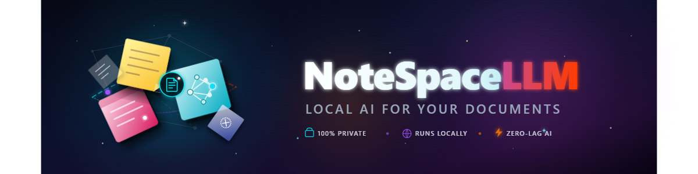
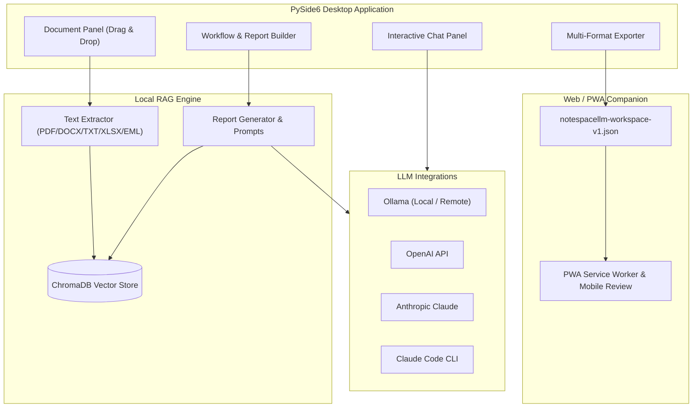

# NoteSpaceLLM

[](LICENSE)
[](https://www.python.org/)
[]()
[](https://github.com/file-bricks)
[](https://github.com/open-bricks)
[](llms.txt)

[English](README.md) | [Deutsch](README_de.md)

> **Local-first document notebook for research and report generation with configurable local or remote language models.**

> [!NOTE]
> **For AI Agents & Automated Workflows:**
> NoteSpaceLLM provides a machine-readable architecture and feature overview in [`llms.txt`](llms.txt).
> The Python and Web Companion test suites are configured to use isolated local data and avoid external provider calls.

NoteSpaceLLM is a local-first PySide6 desktop app for working with PDFs,
Word files, Markdown, mail exports, notes, and research folders. It keeps
project data local by default, supports local or remote Ollama, OpenAI,
Anthropic and Claude Code workflows, and exports analysis results to Markdown,
PDF, DOCX, HTML and TXT. A lightweight Web/PWA Companion is now available for
reviewing exported workspaces on Android, iOS and browser devices without
uploading documents to a server.

**Best-fit searches:** NotebookLM alternative, local RAG document analysis,
local document chat, PySide6 research tool, local-model report generator,
local-first document workflow.

## Quick Start

```bash
git clone https://github.com/file-bricks/NoteSpaceLLM.git
cd NoteSpaceLLM
pip install -r requirements.txt
python main.py
```

On Windows you can also launch via `start.bat`. A local Windows launcher can be built with `build_exe.bat`.

For a guided local bootstrap that installs requirements and creates starter
workflow/profile folders, run `python setup_environment.py` explicitly. Package
metadata and builds use the separate setuptools entry point and do not run it.

Run tests and compile smoke checks with:

```bash
pytest
python -m compileall -q main.py manage_translations.py setup_environment.py translator.py src
cd web_companion
npm test
```

## System Architecture



## Features

- **Document management**: Add files and directories via drag & drop
- **Auto-indexing**: New documents are processed and indexed immediately for RAG
- **Selective analysis**: Check/uncheck documents to include or exclude from reports
- **Sub-queries**: Right-click a document for targeted document-specific research
- **Workflow visualization**: Graphical overview of the report pipeline
- **Chat interface**: Interactive chat over loaded documents with any LLM
- **Claude Code integration**: Structured API responses or hand-off to an interactive Claude Code session
- **Multi-format export**: Output to MD, PDF, DOCX, HTML, TXT
- **Prompt export**: Save the report context as a Markdown prompt for external LLM workflows
- **Ollama connection profiles**: App-wide provider settings can be reused across projects
- **Language behavior**: The desktop interface is currently primarily German. The Web/PWA Companion has a six-language UI (de, en, es, zh, ja, ru); the report-language setting changes generated content, not the desktop UI.
- **Umlaut-safe UI**: German UI strings use native umlauts; the translation scanner avoids English false positives
- **Profiles**: Reusable output-format combinations

## Installation

```bash
# Clone or copy the project folder
cd NoteSpaceLLM

# Install dependencies
pip install -r requirements.txt

# Start the app
python main.py
```

Check dependencies:

```bash
python main.py --check
```

## LLM Configuration

### Ollama (Local — Recommended)

1. [Install Ollama](https://ollama.ai)
2. Download a model: `ollama pull llama3`
3. In the app: Menu > LLM > Use Ollama

### Ollama (Remote Server)

NoteSpaceLLM can connect to a remote Ollama server, e.g. via [ellmos-stack](https://github.com/ellmos-ai/ellmos-stack):

1. In the app: Menu > LLM > Settings
2. **Ollama URL:** `http://your-server:11435` (or your port)
3. **API Key:** If the server is behind an auth proxy (recommended)

> **Tip:** Ollama has no built-in authentication. For remote access, use a reverse proxy (e.g. Nginx) with API key or Basic Auth.

The Ollama endpoint and model are configured in the app-wide settings or the
selected connection profile, not per project. API keys are stored through the
operating system's credential store when saved in the app. The optional
`NOTESPACELLM_OLLAMA_API_KEY` environment variable overrides the saved key and
is never written by the app. Legacy plaintext keys are not sent until you
explicitly migrate them in settings.

When the configured Ollama server is remote, it receives document text used for
embeddings and prompts/context sent for generation. The API key is sent to the
configured URL as a Bearer header. Plain HTTP does not encrypt either content or
credentials; HTTPS behavior depends on the endpoint and its certificate.

### OpenAI

```bash
export OPENAI_API_KEY="<your-openai-api-key>"
```

### Anthropic (Claude)

```bash
export ANTHROPIC_API_KEY="<your-anthropic-api-key>"
```

### Claude Code

Requires the local CLI:

```bash
npm install -g @anthropic-ai/claude-code
```

Two modes are available in the app:
- **API mode**: structured response returned directly into NoteSpaceLLM
- **Chat mode**: hands the prompt off to an interactive Claude Code console

## Usage

### 1. Add Documents

- **Drag & Drop**: Drop files or folders into the left panel
- **Button**: "Add files" or "Add folder"

### 2. Select Documents

- Checkbox: include/exclude documents for analysis
- Buttons: "All" / "None" for bulk selection

### 3. Sub-queries (optional)

Right-click a document:
- **Create summary**: Automatic summary
- **Extract information**: Find specific data
- **Analyse**: Targeted analysis
- **Ask question**: Specific question about the document

### 4. Define main question

Enter the central research question in the workflow panel.

### 5. Choose workflow/report type

- **Analysis**: Comprehensive analysis with recommendations
- **Summary**: Short summary
- **Research report**: Academic structure
- **Comparison**: Systematic document comparison

### 6. Generate report

Click "Create report" — output appears in the right panel.

### 7. Export

Select output formats and click "Export".

### 8. Prompt export

Use **"Export prompt"** to save the current working context as a Markdown file for use in Claude Code or other LLM workflows.

## Web/PWA Companion

Under `web_companion/` is a read-only Companion strand for Android, iOS and
browser. It imports exported `notespacellm-workspace-v1.json` files locally in
the browser, shows the report, document metadata and selected excerpts, and can
export review notes as Markdown. The workspace remains in the current browser
session and must be re-imported after reopening; only review notes and UI locale
are persisted locally.

Local browser test:

```powershell
$env:PYTHONIOENCODING='utf-8'
python -m http.server 8765 -d web_companion
```

Companion smokes:

```powershell
cd web_companion
node --test tests/library.test.mjs
```

The Android/iOS PWA test plan is documented in `web_companion/PWA_TESTPLAN.md`.

## Platform Strategy

The desktop app is the full application for local documents, the RAG index, and
provider connections. The Android, iOS, and browser Web/PWA Companion is
available for reviewing a user-created `notespacellm-workspace-v1.json` export.
For sensitive material, configure local model and embedding endpoints and
review exports before sharing. The exchange contract is documented in
`EXPORTFORMAT.md`.

### macOS and Linux Source Smokes

Additional source smokes run in GitHub Actions:
- `tests/platform_smoke.py` — offscreen PySide6 start, document import, report export, workspace JSON export
- `tests/linux_platform_smoke.py` — Linux-specific wrapper on `ubuntu-latest`

## Project Structure

```
NoteSpaceLLM/
├── main.py                 # Entry point
├── requirements.txt        # Dependencies
├── translator.py           # Translation-catalog scan/helper; no desktop language switch
├── locales/                # Catalog inputs for the translation helper
├── src/
│   ├── core/              # Core functionality
│   │   ├── document_manager.py
│   │   ├── text_extractor.py
│   │   ├── sub_query.py
│   │   └── project.py
│   ├── gui/               # PySide6 UI
│   │   ├── main_window.py
│   │   ├── document_panel.py
│   │   ├── workflow_panel.py
│   │   ├── chat_panel.py
│   │   └── output_panel.py
│   ├── llm/               # LLM integration (local + remote)
│   │   ├── client.py
│   │   ├── ollama_client.py
│   │   ├── openai_client.py
│   │   └── anthropic_client.py
│   └── reports/           # Report generation
│       ├── generator.py
│       ├── templates.py
│       └── exporter.py
├── web_companion/         # PWA Companion
├── data/                  # Project data (gitignored)
├── workflows/             # Workflow definitions
├── profiles/              # Output profiles
└── output/                # Exported reports
```

## Supported File Formats

| Format | Read | Write |
|--------|------|-------|
| PDF    | ✅   | ✅    |
| DOCX   | ✅   | ✅    |
| DOC    | ⚠️   | —     |
| TXT    | ✅   | ✅    |
| MD     | ✅   | ✅    |
| XLSX   | ✅   | —     |
| HTML   | —    | ✅    |
| EML    | ✅   | —     |
| MSG    | ✅   | —     |

⚠️ .doc requires antiword or LibreOffice

## Privacy

NoteSpaceLLM stores project data, document indexes, profiles, workflow settings,
and exports locally in `data/`, `profiles/`, `workflows/`, `output/` and
`chroma_db/`. These folders are intentionally excluded from Git.

When external LLM providers (OpenAI, Anthropic, Claude Code, remote Ollama)
are enabled, prompts and selected document excerpts may be transmitted to those
services. A remote Ollama endpoint also receives document text used for
embeddings. For sensitive documents use local model and embedding endpoints
and review exported reports, chat history and selected excerpts before
sharing; workspace exports are not anonymized.

## Tips

1. **Large document sets**: Select only relevant documents first for faster results
2. **Sub-queries**: Use targeted sub-queries for higher-quality analysis
3. **Ollama**: A local Ollama endpoint supports offline processing.
4. **Workflow ordering**: Steps can be reordered in the workflow panel

## License

AGPL-3.0-only — see [LICENSE](LICENSE)

This project declares PySide6 and PyMuPDF. See the selected upstream license
references in [THIRD_PARTY_LICENSES.md](THIRD_PARTY_LICENSES.md); the project's
own license is AGPL-3.0-only.

## Related Project

[KnowledgeDigest](https://github.com/file-bricks/KnowledgeDigest) is a separate local knowledge database with SQLite/FTS5 search and optional LLM summaries; it is not integrated with NoteSpaceLLM.

---

## Deutsch

Eine lokale Dokumenten- und Rechercheanwendung mit konfigurierbaren lokalen oder externen Sprachmodellen.

### Features

- **Dokumentenverwaltung**: Dateien und Verzeichnisse per Drag & Drop hinzufügen
- **Automatische Extraktion & Auto-Indexierung**: Neue Dokumente werden direkt verarbeitet und für RAG vorbereitet
- **Selektive Auswahl**: Dokumente für Berichterstellung auswählen/abwählen
- **Detailrecherchen**: Rechtsklick für dokumentspezifische Analysen (Sub-Queries)
- **Workflow-Visualisierung**: Grafische Darstellung des Berichtsprozesses
- **Chat-Interface**: Interaktives Chatten über die Dokumente mit LLM
- **Claude Code Integration**: Wahlweise strukturierte API-Antworten oder Übergabe an eine interaktive Claude-Code-Session
- **Multi-Format-Export**: Ausgabe in MD, PDF, DOCX, HTML, TXT
- **Prompt-Export**: Berichtskontext als Markdown-Prompt für externe LLM-Workflows exportieren
- **Ollama-Verbindungsprofile**: Appweite Provider-Einstellungen können in mehreren Projekten verwendet werden
- **Sprachoberflächen**: Die Desktop-Oberfläche ist derzeit überwiegend deutsch. Der Web/PWA-Companion bietet UI-Texte in Deutsch, Englisch, Spanisch, Chinesisch, Japanisch und Russisch; die Berichtssprache ändert nicht die Desktop-Oberfläche.
- **Umlaut-sichere Oberfläche**: Deutsche UI-Texte verwenden echte Umlaute; der Übersetzungs-Scan vermeidet englische False Positives
- **Profile**: Wiederverwendbare Ausgabeformat-Kombinationen

### Installation

```bash
cd NoteSpaceLLM
pip install -r requirements.txt
python main.py
```

Unter Windows alternativ per `start.bat`. Build: `build_exe.bat`

### LLM-Konfiguration

#### Ollama (Lokal — Empfohlen)

1. [Ollama installieren](https://ollama.ai)
2. Modell herunterladen: `ollama pull llama3`
3. In der App: Menü > LLM > Ollama verwenden

#### Ollama (Remote-Server)

Konfigurierbare Server-URL und Modell werden in den appweiten LLM-Einstellungen
oder im ausgewählten Verbindungsprofil verwaltet, nicht pro Projekt. Kompatibel
mit [ellmos-stack](https://github.com/ellmos-ai/ellmos-stack).

Gespeicherte API-Schlüssel verwendet die App über den nativen Zugangsdienst des
Betriebssystems. `NOTESPACELLM_OLLAMA_API_KEY` überschreibt den gespeicherten
Schlüssel, wird aber nie gespeichert. Alte Klartextschlüssel werden erst nach
einer ausdrücklich gestarteten Migration verwendet. Ein entfernter Ollama-Server
erhält Dokumenttext für Embeddings sowie Prompts und Kontext für die Generierung;
der API-Schlüssel wird als Bearer-Header an die konfigurierte URL gesendet. HTTP
verschlüsselt diese Daten nicht.

#### OpenAI / Anthropic (Claude)

```bash
export OPENAI_API_KEY="..."
export ANTHROPIC_API_KEY="..."
```

### Verwendung

1. Dokumente hinzufügen (Drag & Drop oder Buttons)
2. Dokumente auswählen (Checkboxen)
3. Optional: Detailrecherchen per Rechtsklick
4. Hauptfragestellung eingeben
5. Workflow/Berichtsart wählen
6. „Bericht erstellen" klicken
7. Ergebnis exportieren (MD, PDF, DOCX, HTML, TXT)
8. Optional: „Prompt exportieren" für externe LLM-Workflows

### Plattformstrategie

Desktop-App als autoritative Vollversion. Web/PWA-Companion für Android, iOS und Browser über `notespacellm-workspace-v1.json`. Details im [Exportformat](EXPORTFORMAT.md).

## Verwandtes Projekt

[KnowledgeDigest](https://github.com/file-bricks/KnowledgeDigest) ist eine eigenständige lokale Wissensdatenbank mit SQLite/FTS5-Suche und optionalen LLM-Zusammenfassungen; sie ist nicht in NoteSpaceLLM integriert.

---

## Hinweise / Notes

Die Bedingungen der Projektlizenz stehen in [LICENSE](LICENSE). Es gibt keine Zusage für laufende Wartung oder Verfügbarkeit.

See [LICENSE](LICENSE) for the project's license terms. The maintainers do not promise ongoing maintenance or availability.
