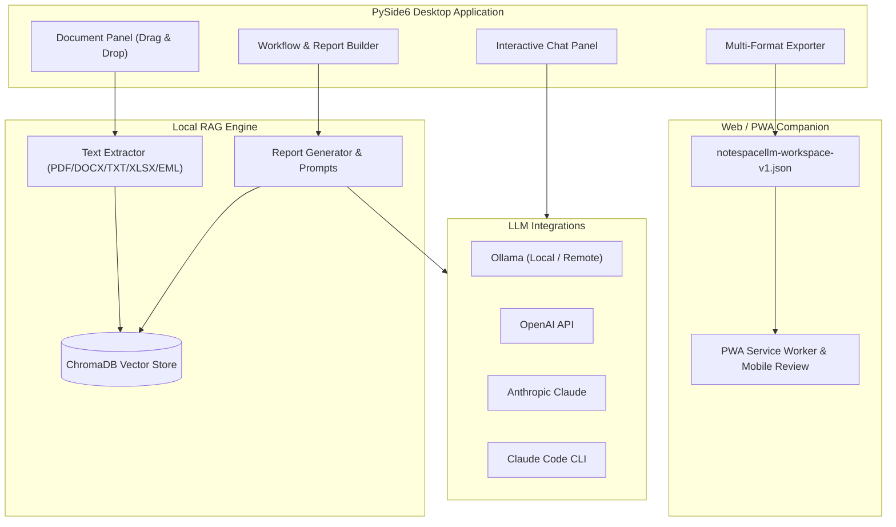

<!-- worldset: {"translated_from_sha256": "466a6a18b88506de47fa858aabc993da82eb017a6be4e93cbd9aea6ac61ec40f", "translator": "claude-haiku-5-5 with gpt-6-luna/max review and repairs", "translated_at": "2026-10-25T08:23:37.463722+00:00", "reviewer": "Root independent source/literal/encoding checks"} -->


# NoteSpaceLLM

[](LICENSE)
[](https://www.python.org/)
[]()
[](https://github.com/file-bricks)
[](https://github.com/open-bricks)
[](llms.txt)

[English](README.md) | [Deutsch](README_de.md) | [Español](README_es.md) | [简体中文](README_zh.md) | [日本語](README_ja.md) | [Русский](README_ru.md) | [Français](README_fr.md) | [हिन्दी](README_hi.md) | [العربية](README_ar.md) | [বাংলা](README_bn.md) | [Português](README_pt.md)

> **دفتر مستندات يعتمد على المعالجة المحلية أولاً للبحث وإنشاء التقارير، مع نماذج لغوية محلية أو عن بُعد قابلة للتهيئة.**

> [!NOTE]
> **لوكلاء الذكاء الاصطناعي وسير العمل الآلي:**
> يوفّر NoteSpaceLLM نظرة عامة على البنية والميزات بصيغة قابلة للقراءة الآلية في [`llms.txt`](llms.txt).

NoteSpaceLLM هو تطبيق سطح مكتب مبني على PySide6 يعتمد على المعالجة المحلية أولاً للعمل مع ملفات PDF وملفات Word وMarkdown وتصدير البريد والملاحظات ومجلدات الأبحاث. يحتفظ التطبيق ببيانات المشروع محلياً افتراضياً، ويدعم سير عمل Ollama وOpenAI وAnthropic وClaude Code محلياً أو عن بُعد، ويصدّر نتائج التحليل إلى Markdown وPDF وDOCX وHTML وTXT. تتوفر الآن أيضاً واجهة Web/PWA خفيفة المعروفة باسم Companion لمراجعة مساحات العمل المُصدَّرة على Android وiOS والأجهزة التي تعمل عبر المتصفح دون رفع المستندات إلى أي خادم.

**عبارات البحث الأنسب:** بديل NotebookLM، تحليل المستندات بتقنية RAG المحلية، الدردشة مع المستندات محلياً، أداة أبحاث مبنية على PySide6، مولّد تقارير بنماذج محلية، سير عمل المستندات القائم على المعالجة المحلية أولاً.

## البدء السريع

```bash
git clone https://github.com/file-bricks/NoteSpaceLLM.git
cd NoteSpaceLLM
pip install -r requirements.txt
python main.py
```

على نظام Windows يمكنك أيضاً التشغيل عبر `start.bat`. يمكن إنشاء مشغّل Windows محلي باستخدام `build_exe.bat`.

لإعداد محلي موجَّه يثبّت المتطلبات وينشئ مجلدات بدء سير العمل والملفات الشخصية، شغّل `python setup_environment.py` صراحةً. أما بيانات الحزمة وعمليات البناء فتستخدم نقطة الدخول المنفصلة في setuptools ولا تُشغّله.

شغّل الاختبارات وفحوص الترجمة الأولية بالأمر:

```bash
pytest
python -m compileall -q main.py manage_translations.py setup_environment.py translator.py src
cd web_companion
npm test
```

## البنية المعمارية للنظام



## الميزات

- **إدارة المستندات**: إضافة الملفات والمجلدات عبر السحب والإفلات
- **الاستخراج والفهرسة التلقائيان**: تتم معالجة المستندات الجديدة فوراً وتجهيزها لتقنية RAG.
- **التحليل الانتقائي**: حدّد أو ألغِ تحديد المستندات لتضمينها في التقارير أو استبعادها منها
- **الاستعلامات الفرعية**: انقر بالزر الأيمن على مستند لإجراء بحث موجَّه خاص بذلك المستند
- **تصوّر سير العمل**: نظرة رسومية عامة على مسار إنشاء التقرير
- **واجهة الدردشة**: محادثة تفاعلية مع المستندات المحمّلة باستخدام أي نموذج لغوي
- **تكامل Claude Code**: استجابات API منظَّمة أو تسليم الجلسة إلى جلسة Claude Code تفاعلية
- **التصدير متعدد الصيغ**: الإخراج بصيغ MD وPDF وDOCX وHTML وTXT
- **تصدير المطالبات**: حفظ سياق التقرير كمطالبة Markdown لسير عمل النماذج اللغوية الخارجية
- **ملفات تعريف اتصال Ollama**: يمكن إعادة استخدام إعدادات الموفّر على مستوى التطبيق عبر المشاريع
- **دعم اللغات**: لا تتيح واجهة سطح المكتب اختيار لغة من قِبل المستخدم، وواجهتها ألمانية في الغالب حالياً. تتضمن واجهة Web/PWA Companion محدِّد لغة واجهة دائم يشمل الألمانية والإنجليزية والإسبانية والصينية المبسطة واليابانية والروسية والفرنسية والهندية والعربية والبنغالية والبرتغالية. يُدرج حقل لغة المشروع في عمليات تصدير مساحات العمل؛ ولا يُربط بواجهة سطح المكتب أو بمحدِّد لغة التقارير.
- **واجهة آمنة للأحرف الخاصة**: تستخدم سلاسل واجهة المستخدم الألمانية الأحرف الخاصة بصيغتها الأصلية؛ ويتجنب الماسح الخاص بالترجمة الإيجابيات الكاذبة الإنجليزية
- **ملفات التعريف**: مجموعات قابلة لإعادة الاستخدام من صيغ الإخراج

## التثبيت

```bash
# Clone or copy the project folder
cd NoteSpaceLLM

# Install dependencies
pip install -r requirements.txt

# Start the app
python main.py
```

تحقق من التبعيات:

```bash
python main.py --check
```

## تهيئة النماذج اللغوية

### Ollama (محلي — موصى به)

1. [ثبّت Ollama](https://ollama.ai)
2. نزّل نموذجاً: `ollama pull llama3`
3. في التطبيق: القائمة > LLM > Use Ollama

### Ollama (خادم عن بُعد)

يمكن لـ NoteSpaceLLM الاتصال بخادم Ollama عن بُعد، مثلاً عبر [ellmos-stack](https://github.com/ellmos-ai/ellmos-stack):

1. في التطبيق: القائمة > LLM > Settings
2. **عنوان Ollama:** `http://your-server:11435` (أو المنفذ الخاص بك)
3. **مفتاح API:** إذا كان الخادم خلف وكيل مصادقة (موصى به)

> **نصيحة:** لا يتضمن Ollama مصادقة مدمجة. للوصول عن بُعد، استخدم وكيلاً عكسياً (مثل Nginx) مع مفتاح API أو Basic Auth.

تُهيَّأ نقطة نهاية Ollama والنموذج في إعدادات التطبيق العامة أو في ملف تعريف الاتصال المحدد، لا لكل مشروع على حدة. تُخزَّن مفاتيح API عبر مخزن بيانات الاعتماد في نظام التشغيل عند حفظها داخل التطبيق. يتجاوز متغيّر البيئة الاختياري `NOTESPACELLM_OLLAMA_API_KEY` المفتاح المحفوظ، ولا يكتبه التطبيق أبداً. لا تُرسَل المفاتيح القديمة المخزّنة كنص عادي إلا بعد أن تنقلها صراحةً من الإعدادات.

عندما يكون خادم Ollama المُهيَّأ بعيدًا، فإنه يتلقى نص المستندات المستخدم في التضمينات (embeddings)، كما يتلقى المطالبات (prompts) والسياق المرسل للتوليد. يُرسَل مفتاح API إلى عنوان URL المُهيَّأ على هيئة ترويسة Bearer. لا يُشفِّر بروتوكول HTTP العادي المحتوى ولا بيانات الاعتماد، أما سلوك HTTPS فيعتمد على نقطة النهاية وشهادتها.

### OpenAI

```bash
export OPENAI_API_KEY="<your-openai-api-key>"
```

### Anthropic (Claude)

```bash
export ANTHROPIC_API_KEY="<your-anthropic-api-key>"
```

### Claude Code

يتطلب واجهة سطر الأوامر المحلية:

```bash
npm install -g @anthropic-ai/claude-code
```

يتوفر في التطبيق وضعان:
- **وضع API**: تُعاد الاستجابة المنظَّمة مباشرة إلى NoteSpaceLLM
- **وضع الدردشة**: تُسلَّم المطالبة إلى وحدة تحكم تفاعلية في Claude Code

## الاستخدام

### 1. إضافة المستندات

- **السحب والإفلات**: أسقِط الملفات أو المجلدات في اللوحة اليسرى
- **الزر**: "Add files" أو "Add folder"

### 2. تحديد المستندات

- مربع الاختيار: تضمين المستندات في التحليل أو استبعادها منه
- الأزرار: "All" / "None" للتحديد الجماعي

### 3. الاستعلامات الفرعية (اختياري)

انقر بالزر الأيمن على مستند:
- **Create summary**: ملخص تلقائي
- **Extract information**: البحث عن بيانات محددة
- **Analyse**: تحليل موجَّه
- **Ask question**: سؤال محدد عن المستند

### 4. تحديد السؤال الرئيسي

أدخِل سؤال البحث المحوري في لوحة سير العمل.

### 5. اختيار نوع سير العمل/التقرير

- **Analysis**: تحليل شامل مع توصيات
- **Summary**: ملخص قصير
- **Research report**: بنية أكاديمية
- **Comparison**: مقارنة منهجية للمستندات

### 6. إنشاء التقرير

انقر "Create report"، وسيظهر الناتج في اللوحة اليمنى.

### 7. التصدير

اختر تنسيقات المخرجات وانقر "Export".

### 8. تصدير المطالبة

استخدم **"Export prompt"** لحفظ سياق العمل الحالي كملف Markdown لاستخدامه في Claude Code أو في سير عمل LLM آخر.

## الرفيق على الويب/PWA

تحت `web_companion/` يوجد مسار Companion للقراءة فقط يعمل على Android وiOS والمتصفح. يستورد ملفات `notespacellm-workspace-v1.json` المُصدَّرة محليًا في المتصفح، ويعرض التقرير وبيانات المستندات الوصفية والمقتطفات المحددة، ويمكنه تصدير ملاحظات المراجعة بصيغة Markdown. تبقى مساحة العمل في جلسة المتصفح الحالية، ويجب إعادة استيرادها بعد إعادة فتح الصفحة؛ ولا يُحفَظ محليًا إلا ملاحظات المراجعة وإعداد لغة الواجهة.

اختبار المتصفح المحلي:

```powershell
$env:PYTHONIOENCODING='utf-8'
python -m http.server 8765 -d web_companion
```

اختبارات Companion السريعة:

```powershell
cd web_companion
node --test tests/library.test.mjs
```

خطة اختبار PWA لـ Android/iOS موثقة في `web_companion/PWA_TESTPLAN.md`.

## استراتيجية المنصات

تطبيق سطح المكتب هو التطبيق الكامل للمستندات المحلية وفهرس RAG واتصالات المزودين. يتوفر Web/PWA Companion على Android وiOS والمتصفح لمراجعة ملف `notespacellm-workspace-v1.json` الذي يُنشئه المستخدم.
للمواد الحساسة، هيِّئ نقاط نهاية محلية للنموذج والتضمينات، وراجع الملفات المُصدَّرة قبل مشاركتها. عقد التبادل موثق في `EXPORTFORMAT.md`.

### اختبارات المصدر على macOS وLinux

تعمل اختبارات مصدر إضافية في GitHub Actions:
- `tests/platform_smoke.py` — تشغيل PySide6 دون واجهة، واستيراد المستندات، وتصدير التقرير، وتصدير JSON لمساحة العمل
- `tests/linux_platform_smoke.py` — غلاف خاص بـ Linux فوق `ubuntu-latest`

## بنية المشروع

```
NoteSpaceLLM/
├── main.py                 # Entry point
├── requirements.txt        # Dependencies
├── translator.py           # Translation-catalog scan/helper; no desktop language switch
├── locales/                # Catalog inputs for the translation helper
├── src/
│   ├── core/              # Core functionality
│   │   ├── document_manager.py
│   │   ├── text_extractor.py
│   │   ├── sub_query.py
│   │   └── project.py
│   ├── gui/               # PySide6 UI
│   │   ├── main_window.py
│   │   ├── document_panel.py
│   │   ├── workflow_panel.py
│   │   ├── chat_panel.py
│   │   └── output_panel.py
│   ├── llm/               # LLM integration (local + remote)
│   │   ├── client.py
│   │   ├── ollama_client.py
│   │   ├── openai_client.py
│   │   └── anthropic_client.py
│   └── reports/           # Report generation
│       ├── generator.py
│       ├── templates.py
│       └── exporter.py
├── web_companion/         # PWA Companion
├── data/                  # Project data (gitignored)
├── workflows/             # Workflow definitions
├── profiles/              # Output profiles
└── output/                # Exported reports
```

## صيغ الملفات المدعومة

| الصيغة | القراءة | الكتابة |
|--------|---------|---------|
| PDF    | ✅      | ✅      |
| DOCX   | ✅      | ✅      |
| DOC    | ⚠️      | —       |
| TXT    | ✅      | ✅      |
| MD     | ✅      | ✅      |
| XLSX   | ✅      | —       |
| HTML   | —       | ✅      |
| EML    | ✅      | —       |
| MSG    | ✅      | —       |

⚠️ يتطلب ملف .doc الأداة antiword أو LibreOffice

## الخصوصية

يخزّن NoteSpaceLLM بيانات المشروع وفهارس المستندات والملفات الشخصية وإعدادات سير العمل والتصديرات محليًا في `data/` و`profiles/` و`workflows/` و`output/` و`chroma_db/`. هذه المجلدات مستثناة من Git عمدًا.

عند تفعيل مزودي LLM الخارجيين (OpenAI وAnthropic وClaude Code وOllama البعيد)، قد تُرسَل المطالبات ومقتطفات المستندات المحددة إلى تلك الخدمات. كما يتلقى نقطة نهاية Ollama البعيدة نص المستندات المستخدم في التضمينات. للمستندات الحساسة، استخدم نقاط نهاية محلية للنموذج والتضمين، وراجع التقارير المُصدَّرة وسجل الدردشة والمقتطفات المحددة قبل مشاركتها؛ فتصديرات مساحة العمل غير مجهَّلة الهوية.

## نصائح

1. **مجموعات المستندات الكبيرة**: حدِّد المستندات ذات الصلة فقط أولًا للحصول على نتائج أسرع
2. **الاستعلامات الفرعية**: استخدم استعلامات فرعية موجَّهة للحصول على تحليل أعلى جودة
3. **Ollama**: تتيح نقطة نهاية Ollama المحلية المعالجة دون اتصال.
4. **ترتيب سير العمل**: يمكن إعادة ترتيب الخطوات في لوحة سير العمل

## الترخيص

AGPL-3.0-only — انظر [LICENSE](LICENSE)

يُعلن هذا المشروع استخدام PySide6 وPyMuPDF. انظر مراجع التراخيص الأصلية المختارة في [THIRD_PARTY_LICENSES.md](THIRD_PARTY_LICENSES.md)؛ أما ترخيص المشروع نفسه فهو AGPL-3.0-only.

## مشروع ذو صلة

[KnowledgeDigest](https://github.com/file-bricks/KnowledgeDigest) قاعدة معرفية محلية منفصلة تعتمد على البحث SQLite/FTS5 وملخصات LLM اختيارية؛ وهي غير مدمجة مع NoteSpaceLLM.

## إشعار الترخيص والصيانة

راجع [LICENSE](LICENSE) لشروط ترخيص المشروع. لا يَعِد القائمون على المشروع بصيانة مستمرة أو بتوافر دائم.
