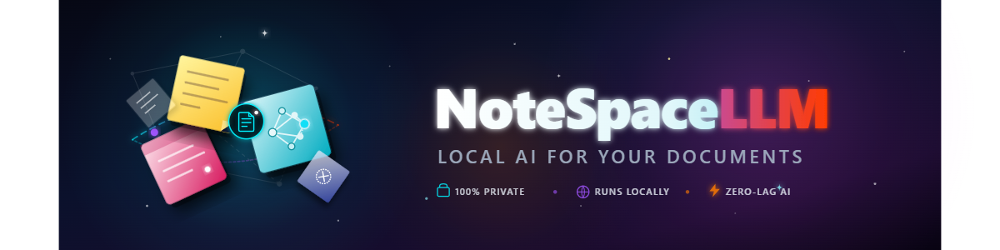
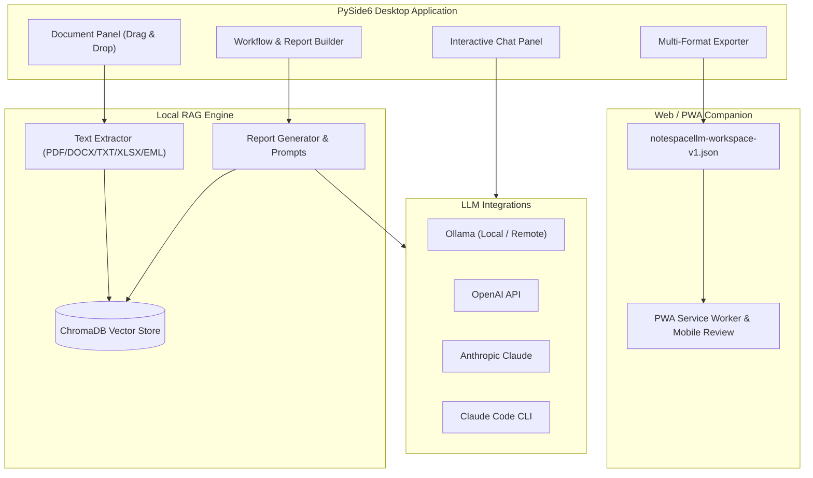

<!-- worldset: {"translated_from_sha256": "5156cab29500f95cbddd18a51dac493ccd36033b452d6cee3bd12f1ad5893194", "translator": "claude-haiku-5-5 with gpt-6-luna/max review and repairs", "translated_at": "2026-10-25T08:23:38.290430+00:00", "reviewer": "Root independent source/literal/encoding checks"} -->


# NoteSpaceLLM

[](LICENSE)
[](https://www.python.org/)
[]()
[](https://github.com/file-bricks)
[](https://github.com/open-bricks)
[](llms.txt)

[English](README.md) | [Deutsch](README_de.md) | [Español](README_es.md) | [简体中文](README_zh.md) | [日本語](README_ja.md) | [Русский](README_ru.md) | [Français](README_fr.md) | [हिन्दी](README_hi.md) | [العربية](README_ar.md) | [বাংলা](README_bn.md) | [Português](README_pt.md)

> **গবেষণা ও প্রতিবেদন তৈরির জন্য স্থানীয়-প্রথম (local-first) নথি নোটবুক, যেখানে কনফিগারযোগ্য স্থানীয় বা দূরবর্তী ভাষা মডেল ব্যবহার করা যায়।**

> [!NOTE]
> **AI এজেন্ট ও স্বয়ংক্রিয় ওয়ার্কফ্লোর জন্য:**
> NoteSpaceLLM [`llms.txt`](llms.txt)-এ একটি মেশিন-পাঠযোগ্য আর্কিটেকচার ও বৈশিষ্ট্যের সংক্ষিপ্ত বিবরণ প্রদান করে।

NoteSpaceLLM হলো একটি স্থানীয়-প্রথম PySide6 ডেস্কটপ অ্যাপ্লিকেশন, যা PDF,
Word ফাইল, Markdown, মেইল এক্সপোর্ট, নোট এবং গবেষণা ফোল্ডারের সাথে কাজ করতে
ব্যবহৃত হয়। এটি ডিফল্টভাবে প্রকল্পের ডেটা স্থানীয়ভাবে রাখে, স্থানীয় বা দূরবর্তী
Ollama, OpenAI, Anthropic ও Claude Code ওয়ার্কফ্লো সমর্থন করে এবং বিশ্লেষণের
ফলাফল Markdown, PDF, DOCX, HTML ও TXT ফরম্যাটে রপ্তানি করে। একটি হালকা Web/PWA
Companion এখন উপলব্ধ, যার মাধ্যমে কোনো সার্ভারে নথি আপলোড না করেই Android, iOS ও
ব্রাউজার ডিভাইসে রপ্তানিকৃত ওয়ার্কস্পেস পর্যালোচনা করা যায়।

**সেরা-মানানসই অনুসন্ধান:** NotebookLM বিকল্প, স্থানীয় RAG নথি বিশ্লেষণ,
স্থানীয় নথি চ্যাট, PySide6 গবেষণা টুল, স্থানীয়-মডেল প্রতিবেদন জেনারেটর,
স্থানীয়-প্রথম নথি ওয়ার্কফ্লো।

## দ্রুত শুরু

```bash
git clone https://github.com/file-bricks/NoteSpaceLLM.git
cd NoteSpaceLLM
pip install -r requirements.txt
python main.py
```

Windows-এ আপনি `start.bat` দিয়েও চালু করতে পারেন। একটি স্থানীয় Windows লঞ্চার `build_exe.bat` ব্যবহার করে তৈরি করা যায়।

প্রয়োজনীয় নির্ভরতা ইনস্টল করে এবং স্টার্টার ওয়ার্কফ্লো/প্রোফাইল ফোল্ডার তৈরি করে
এমন একটি নির্দেশিত স্থানীয় বুটস্ট্র্যাপের জন্য স্পষ্টভাবে `python setup_environment.py` চালান।
প্যাকেজ মেটাডেটা ও বিল্ডে আলাদা setuptools এন্ট্রি পয়েন্ট ব্যবহৃত হয় এবং তা এটি চালায় না।

টেস্ট চালাতে এবং কম্পাইল স্মোক চেক করতে:

```bash
pytest
python -m compileall -q main.py manage_translations.py setup_environment.py translator.py src
cd web_companion
npm test
```

## সিস্টেম আর্কিটেকচার



## বৈশিষ্ট্যসমূহ

- **নথি ব্যবস্থাপনা**: ড্র্যাগ ও ড্রপের মাধ্যমে ফাইল ও ডিরেক্টরি যোগ করুন
- **স্বয়ংক্রিয় নিষ্কাশন ও ইনডেক্সিং**: নতুন নথি সঙ্গে সঙ্গে প্রক্রিয়া করা হয় এবং RAG-এর জন্য প্রস্তুত করা হয়।
- **নির্বাচনভিত্তিক বিশ্লেষণ**: প্রতিবেদনে অন্তর্ভুক্ত বা বাদ দিতে নথি চেক/আনচেক করুন
- **উপ-প্রশ্ন (Sub-queries)**: নির্দিষ্ট নথি-ভিত্তিক লক্ষ্যযুক্ত গবেষণার জন্য কোনো নথিতে ডান-ক্লিক করুন
- **ওয়ার্কফ্লো ভিজ্যুয়ালাইজেশন**: প্রতিবেদন পাইপলাইনের গ্রাফিক্যাল ওভারভিউ
- **চ্যাট ইন্টারফেস**: যেকোনো LLM দিয়ে লোড করা নথির উপর ইন্টারেক্টিভ চ্যাট
- **Claude Code ইন্টিগ্রেশন**: কাঠামোবদ্ধ API প্রতিক্রিয়া বা একটি ইন্টারেক্টিভ Claude Code সেশনে হস্তান্তর
- **মাল্টি-ফরম্যাট রপ্তানি**: MD, PDF, DOCX, HTML, TXT-এ আউটপুট
- **প্রম্পট রপ্তানি**: বাহ্যিক LLM ওয়ার্কফ্লোর জন্য প্রতিবেদনের প্রসঙ্গ Markdown প্রম্পট হিসেবে সংরক্ষণ করুন
- **Ollama সংযোগ প্রোফাইল**: অ্যাপ-ব্যাপী প্রদানকারী সেটিংস বিভিন্ন প্রকল্পে পুনর্ব্যবহার করা যায়
- **ভাষা সমর্থন**: ডেস্কটপ ও Web/PWA Companion ইন্টারফেসে ইংরেজি, জার্মান, স্প্যানিশ, সরলীকৃত চীনা, জাপানি, রুশ, ফরাসি, হিন্দি, আরবি, বাংলা ও পর্তুগিজের জন্য সংরক্ষিত ভাষা নির্বাচক রয়েছে। আরবি ডান-থেকে-বামে বিন্যাস ব্যবহার করে। প্রকল্পের ভাষা-ক্ষেত্রটি ওয়ার্কস্পেস রপ্তানিতে মেটাডেটা হিসেবে অন্তর্ভুক্ত হয়; এটি ইন্টারফেসের ভাষা বদলায় না বা তৈরি প্রতিবেদনের ভাষা নির্ধারণ করে না।
- **Umlaut-নিরাপদ UI**: জার্মান UI স্ট্রিংয়ে স্থানীয় umlaut ব্যবহৃত হয়; অনুবাদ স্ক্যানার ইংরেজি মিথ্যা পজিটিভ এড়ায়
- **প্রোফাইল**: পুনর্ব্যবহারযোগ্য আউটপুট-ফরম্যাট সমন্বয়

## ইনস্টলেশন

```bash
# Clone or copy the project folder
cd NoteSpaceLLM

# Install dependencies
pip install -r requirements.txt

# Start the app
python main.py
```

নির্ভরতা পরীক্ষা করুন:

```bash
python main.py --check
```

## LLM কনফিগারেশন

### Ollama (স্থানীয় — প্রস্তাবিত)

1. [Ollama ইনস্টল করুন](https://ollama.ai)
2. একটি মডেল ডাউনলোড করুন: `ollama pull llama3`
3. অ্যাপে: Menu > LLM > Use Ollama

### Ollama (দূরবর্তী সার্ভার)

NoteSpaceLLM একটি দূরবর্তী Ollama সার্ভারের সাথে সংযুক্ত হতে পারে, যেমন [ellmos-stack](https://github.com/ellmos-ai/ellmos-stack)-এর মাধ্যমে:

1. অ্যাপে: Menu > LLM > Settings
2. **Ollama URL:** `http://your-server:11435` (বা আপনার পোর্ট)
3. **API Key:** সার্ভার যদি auth proxy-এর পেছনে থাকে (প্রস্তাবিত)

> **টিপ:** Ollama-তে কোনো অন্তর্নির্মিত প্রমাণীকরণ নেই। দূরবর্তী অ্যাক্সেসের জন্য API key বা Basic Auth সহ একটি reverse proxy (যেমন Nginx) ব্যবহার করুন।

Ollama endpoint ও মডেল অ্যাপ-ব্যাপী সেটিংসে বা নির্বাচিত সংযোগ প্রোফাইলে কনফিগার
করা হয়, প্রতি প্রকল্পে নয়। অ্যাপে সংরক্ষণ করা হলে API key অপারেটিং সিস্টেমের
credential store-এর মাধ্যমে সংরক্ষিত হয়। ঐচ্ছিক `NOTESPACELLM_OLLAMA_API_KEY` এনভায়রনমেন্ট ভেরিয়েবল
সংরক্ষিত কী-কে ওভাররাইড করে এবং অ্যাপ তা কখনো লেখে না। লিগ্যাসি প্লেইনটেক্সট কী
সেটিংসে আপনি স্পষ্টভাবে মাইগ্রেট না করা পর্যন্ত পাঠানো হয় না।

কনফিগার করা Ollama সার্ভারটি দূরবর্তী হলে, এমবেডিংয়ের জন্য ব্যবহৃত নথির পাঠ্য এবং তৈরি করার জন্য পাঠানো প্রম্পট/প্রসঙ্গ সেই সার্ভার পায়। API key কনফিগার করা URL-এ Bearer হেডার হিসেবে পাঠানো হয়। সাধারণ HTTP বিষয়বস্তু বা প্রমাণীকরণ-তথ্য এনক্রিপ্ট করে না; HTTPS-এর আচরণ নির্ভর করে এন্ডপয়েন্ট ও তার সার্টিফিকেটের ওপর।

### OpenAI

```bash
export OPENAI_API_KEY="<your-openai-api-key>"
```

### Anthropic (Claude)

```bash
export ANTHROPIC_API_KEY="<your-anthropic-api-key>"
```

### Claude Code

স্থানীয় CLI প্রয়োজন:

```bash
npm install -g @anthropic-ai/claude-code
```

অ্যাপে দুটি মোড উপলব্ধ:
- **API মোড**: কাঠামোগত প্রতিক্রিয়া সরাসরি NoteSpaceLLM-এ ফেরত আসে
- **চ্যাট মোড**: প্রম্পটটি একটি ইন্টারেক্টিভ Claude Code কনসোলে হস্তান্তর করা হয়

## ব্যবহার

### ১. নথি যোগ করুন

- **ড্র্যাগ ও ড্রপ**: বাম প্যানেলে ফাইল বা ফোল্ডার ড্রপ করুন
- **বোতাম**: "Add files" বা "Add folder"

### ২. নথি নির্বাচন করুন

- চেকবক্স: বিশ্লেষণের জন্য নথি অন্তর্ভুক্ত/বাদ দিন
- বোতাম: বাল্ক নির্বাচনের জন্য "All" / "None"

### ৩. সাব-কোয়েরি (ঐচ্ছিক)

একটি নথিতে ডান-ক্লিক করুন:
- **Create summary**: স্বয়ংক্রিয় সারসংক্ষেপ
- **Extract information**: নির্দিষ্ট তথ্য খুঁজুন
- **Analyse**: লক্ষ্যভিত্তিক বিশ্লেষণ
- **Ask question**: নথি সম্পর্কে নির্দিষ্ট প্রশ্ন

### ৪. মূল প্রশ্ন সংজ্ঞায়িত করুন

ওয়ার্কফ্লো প্যানেলে কেন্দ্রীয় গবেষণা প্রশ্নটি লিখুন।

### ৫. ওয়ার্কফ্লো/রিপোর্ট প্রকার বেছে নিন

- **Analysis**: সুপারিশসহ ব্যাপক বিশ্লেষণ
- **Summary**: সংক্ষিপ্ত সারসংক্ষেপ
- **Research report**: একাডেমিক কাঠামো
- **Comparison**: নথির পদ্ধতিগত তুলনা

### ৬. রিপোর্ট তৈরি করুন

"Create report" ক্লিক করুন — আউটপুট ডান প্যানেলে প্রদর্শিত হবে।

### ৭. রপ্তানি

আউটপুট ফর্ম্যাট নির্বাচন করুন এবং "Export" ক্লিক করুন।

### ৮. প্রম্পট রপ্তানি

বর্তমান কার্যপ্রবাহের প্রেক্ষাপট একটি Markdown ফাইলে সংরক্ষণ করতে **"Export prompt"** ব্যবহার করুন, যা Claude Code বা অন্যান্য LLM কার্যপ্রবাহে ব্যবহারের জন্য।

## Web/PWA কম্প্যানিয়ন

`web_companion/`-এর অধীনে Android, iOS এবং ব্রাউজারের জন্য একটি শুধুমাত্র-পঠনযোগ্য Companion স্ট্র্যান্ড রয়েছে। এটি ব্রাউজারে স্থানীয়ভাবে রপ্তানি করা `notespacellm-workspace-v1.json` ফাইল আমদানি করে, রিপোর্ট, নথির মেটাডেটা ও নির্বাচিত অংশ দেখায়, এবং রিভিউ নোটগুলো Markdown হিসেবে রপ্তানি করতে পারে। ওয়ার্কস্পেস বর্তমান ব্রাউজার সেশনে থাকে এবং ব্রাউজার পুনরায় খোলার পর আবার আমদানি করতে হবে; শুধুমাত্র রিভিউ নোট ও UI লোকেল স্থানীয়ভাবে সংরক্ষিত হয়।

স্থানীয় ব্রাউজার পরীক্ষা:

```powershell
$env:PYTHONIOENCODING='utf-8'
python -m http.server 8765 -d web_companion
```

Companion স্মোক:

```powershell
cd web_companion
node --test tests/library.test.mjs
```

Android/iOS PWA পরীক্ষার পরিকল্পনা `web_companion/PWA_TESTPLAN.md`-এ নথিভুক্ত আছে।

## প্ল্যাটফর্ম কৌশল

ডেস্কটপ অ্যাপটি স্থানীয় নথি, RAG ইনডেক্স এবং প্রদানকারী সংযোগের জন্য সম্পূর্ণ অ্যাপ্লিকেশন। Android, iOS ও ব্রাউজার Web/PWA Companion ব্যবহারকারী-তৈরি `notespacellm-workspace-v1.json` রপ্তানি পর্যালোচনার জন্য উপলব্ধ। সংবেদনশীল উপাদানের ক্ষেত্রে স্থানীয় মডেল ও এম্বেডিং এন্ডপয়েন্ট কনফিগার করুন এবং শেয়ার করার আগে রপ্তানি পর্যালোচনা করুন। বিনিময় চুক্তি `EXPORTFORMAT.md`-এ নথিভুক্ত আছে।

### macOS ও Linux সোর্স স্মোক

GitHub Actions-এ অতিরিক্ত সোর্স স্মোক চলে:
- `tests/platform_smoke.py` — অফস্ক্রিন PySide6 চালু, নথি আমদানি, রিপোর্ট রপ্তানি, ওয়ার্কস্পেস JSON রপ্তানি
- `tests/linux_platform_smoke.py` — `ubuntu-latest`-এর উপর Linux-নির্দিষ্ট র‍্যাপার

## প্রকল্পের কাঠামো

```
NoteSpaceLLM/
├── main.py                 # Entry point
├── requirements.txt        # Dependencies
├── translator.py           # Translation system and catalog scanner used by the desktop UI
├── locales/                # Catalog inputs for the translation helper
├── src/
│   ├── core/              # Core functionality
│   │   ├── document_manager.py
│   │   ├── text_extractor.py
│   │   ├── sub_query.py
│   │   └── project.py
│   ├── gui/               # PySide6 UI
│   │   ├── main_window.py
│   │   ├── document_panel.py
│   │   ├── workflow_panel.py
│   │   ├── chat_panel.py
│   │   └── output_panel.py
│   ├── llm/               # LLM integration (local + remote)
│   │   ├── client.py
│   │   ├── ollama_client.py
│   │   ├── openai_client.py
│   │   └── anthropic_client.py
│   └── reports/           # Report generation
│       ├── generator.py
│       ├── templates.py
│       └── exporter.py
├── web_companion/         # PWA Companion
├── data/                  # Project data (gitignored)
├── workflows/             # Workflow definitions
├── profiles/              # Output profiles
└── output/                # Exported reports
```

## সমর্থিত ফাইল ফরম্যাট

| ফরম্যাট | পড়া | লেখা |
|--------|------|-------|
| PDF    | ✅   | ✅    |
| DOCX   | ✅   | ✅    |
| DOC    | ⚠️   | —     |
| TXT    | ✅   | ✅    |
| MD     | ✅   | ✅    |
| XLSX   | ✅   | —     |
| HTML   | —    | ✅    |
| EML    | ✅   | —     |
| MSG    | ✅   | —     |

⚠️ .doc-এর জন্য antiword বা LibreOffice প্রয়োজন

## গোপনীয়তা

NoteSpaceLLM প্রকল্পের ডেটা, নথি ইনডেক্স, প্রোফাইল, ওয়ার্কফ্লো সেটিংস এবং রপ্তানি স্থানীয়ভাবে `data/`, `profiles/`, `workflows/`, `output/` এবং `chroma_db/`-এ সংরক্ষণ করে। এই ফোল্ডারগুলো ইচ্ছাকৃতভাবে Git থেকে বাদ দেওয়া হয়েছে।

বাহ্যিক LLM প্রদানকারী (OpenAI, Anthropic, Claude Code, দূরবর্তী Ollama) সক্রিয় থাকলে প্রম্পট ও নির্বাচিত নথির অংশ সেই সেবাগুলোতে পাঠানো হতে পারে। দূরবর্তী Ollama এন্ডপয়েন্ট এম্বেডিংয়ে ব্যবহৃত নথির টেক্সটও পায়। সংবেদনশীল নথির জন্য স্থানীয় মডেল ও এম্বেডিং এন্ডপয়েন্ট ব্যবহার করুন এবং শেয়ার করার আগে রপ্তানি করা রিপোর্ট, চ্যাট ইতিহাস ও নির্বাচিত অংশ পর্যালোচনা করুন; ওয়ার্কস্পেস রপ্তানি বেনামী করা হয় না।

## টিপস

1. **বড় নথির সেট**: দ্রুত ফলাফলের জন্য প্রথমে শুধু প্রাসঙ্গিক নথি নির্বাচন করুন
2. **সাব-কোয়েরি**: উচ্চমানের বিশ্লেষণের জন্য লক্ষ্যভিত্তিক সাব-কোয়েরি ব্যবহার করুন
3. **Ollama**: একটি স্থানীয় Ollama এন্ডপয়েন্ট অফলাইন প্রক্রিয়াকরণ সমর্থন করে।
4. **ওয়ার্কফ্লো ক্রম**: ওয়ার্কফ্লো প্যানেলে ধাপগুলোর ক্রম পরিবর্তন করা যায়

## লাইসেন্স

AGPL-3.0-only — দেখুন [LICENSE](LICENSE)

এই প্রকল্পটি PySide6 ও PyMuPDF ঘোষণা করে। নির্বাচিত upstream লাইসেন্স রেফারেন্সের জন্য দেখুন [THIRD_PARTY_LICENSES.md](THIRD_PARTY_LICENSES.md); প্রকল্পের নিজস্ব লাইসেন্স AGPL-3.0-only।

## সম্পর্কিত প্রকল্প

[KnowledgeDigest](https://github.com/file-bricks/KnowledgeDigest) একটি আলাদা স্থানীয় জ্ঞানভান্ডার, যেখানে SQLite/FTS5 অনুসন্ধান ও ঐচ্ছিক LLM সারসংক্ষেপ রয়েছে; এটি NoteSpaceLLM-এর সাথে সংযুক্ত নয়।

## লাইসেন্স ও রক্ষণাবেক্ষণ বিজ্ঞপ্তি

প্রকল্পের লাইসেন্স শর্তাবলীর জন্য দেখুন [LICENSE](LICENSE)। রক্ষণাবেক্ষকরা চলমান রক্ষণাবেক্ষণ বা প্রাপ্যতার কোনো প্রতিশ্রুতি দেন না।
