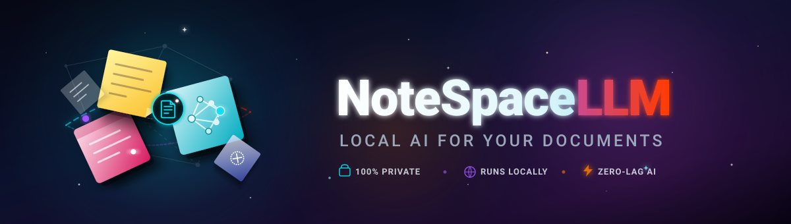
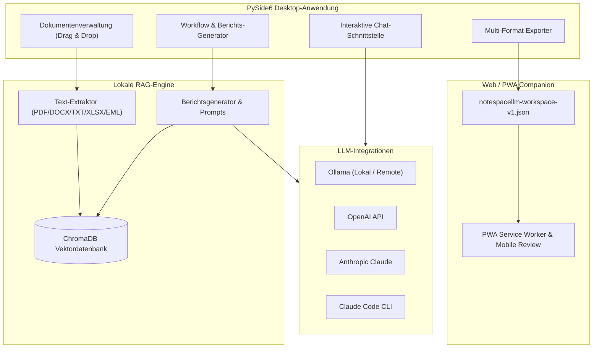

# NoteSpaceLLM

[](LICENSE)
[](https://www.python.org/)
[]()
[](https://github.com/file-bricks)
[](https://github.com/open-bricks)
[](llms.txt)

[Deutsch](README_de.md) | [English](README.md)

> **Lokale Dokumenten- und Rechercheanwendung mit konfigurierbaren lokalen oder externen Sprachmodellen.**

> [!NOTE]
> **Für KI-Agenten & automatisierte Systeme:**
> NoteSpaceLLM bietet eine maschinenlesbare Architektur- und Funktionsübersicht in [`llms.txt`](llms.txt).
> Die Python- und Web-Companion-Tests sind für isolierte lokale Daten eingerichtet und rufen keine externen Modellanbieter auf.

Analysiert lokale Dokumente (PDF, DOCX, TXT, Markdown, XLSX, EML, MSG) lokal. Bei ausdrücklich konfigurierten externen LLM-Anbietern werden ausgewählte Texte und Prompts an diese Anbieter übertragen. Unterstützt lokale und externe Ollama-Server, OpenAI, Anthropic sowie Claude-Code-Workflows. Ergebnisse lassen sich in Markdown, PDF, DOCX, HTML und TXT exportieren. Mit dem Web/PWA-Companion können exportierte Workspaces auch unterwegs auf Smartphone oder Tablet (Android/iOS) eingesehen werden.

## Schnellstart

```bash
git clone https://github.com/file-bricks/NoteSpaceLLM.git
cd NoteSpaceLLM
pip install -r requirements.txt
python main.py
```

Unter Windows kann die Anwendung auch über `start.bat` gestartet werden. Ein Windows-Executable lässt sich mit `build_exe.bat` bauen.

Für einen geführten lokalen Bootstrap, der Abhängigkeiten installiert und
Startordner für Workflows/Profile anlegt, kann `python setup_environment.py`
ausdrücklich ausgeführt werden. Paketmetadaten und Builds starten diesen Installer nicht.

Tests und Kompilierungs-Checks ausführen:

```bash
pytest
python -m compileall -q main.py manage_translations.py setup_environment.py translator.py src
cd web_companion
npm test
```

## Systemarchitektur



## Hauptfunktionen

- **Dokumentenverwaltung**: Dateien und Ordner per Drag & Drop hinzufügen
- **Auto-Indizierung**: Neue Dokumente werden sofort für die RAG-Vektordatenbank (ChromaDB) verarbeitet
- **Selektive Analyse**: Dokumente gezielt per Checkbox für Berichte aktivieren oder deaktivieren
- **Unteranfragen (Sub-queries)**: Rechtsklick auf Dokumente für gezielte Einzeldokument-Recherche
- **Workflow-Visualisierung**: Grafische Übersicht der Berichtspipeline
- **Chat-Schnittstelle**: Interaktiver Chat über alle geladenen Dokumente mit beliebigen LLMs
- **Claude Code Integration**: Strukturierte Antwort-Prompts oder Übergabe an eine interaktive Claude-Code-Session
- **Multi-Format Export**: Ausgabe nach MD, PDF, DOCX, HTML, TXT
- **Prompt Export**: Kontext als Markdown-Prompt für externe KI-Tools speichern
- **Ollama-Verbindungsprofile**: Appweite Provider-Einstellungen können in mehreren Projekten verwendet werden
- **Desktop-Oberfläche**: Derzeit überwiegend deutsch; die Berichtssprache ändert den Bericht, nicht die Desktop-Oberfläche.
- **Web/PWA Companion**: Oberfläche zur Durchsicht exportierter Workspaces mit Sprachwahl in Deutsch, Englisch, Spanisch, Chinesisch, Japanisch und Russisch

## Installation & Abhängigkeiten

```bash
# Repository klonen
cd NoteSpaceLLM

# Python-Abhängigkeiten installieren
pip install -r requirements.txt

# Anwendung starten
python main.py
```

Abhängigkeiten überprüfen:

```bash
python main.py --check
```

## LLM-Konfiguration

### Ollama (Lokal — Empfohlen)

1. [Ollama installieren](https://ollama.ai)
2. Modell herunterladen: `ollama pull llama3`
3. In der App: Menü > LLM > Ollama verwenden

### Ollama (Remote Server)

NoteSpaceLLM kann mit entfernten Ollama-Instanzen verbunden werden (z. B. via [ellmos-stack](https://github.com/ellmos-ai/ellmos-stack)):

1. In der App: Menü > LLM > Einstellungen
2. **Ollama URL:** `http://dein-server:11435`
3. **API Key:** Falls der Server durch einen Auth-Proxy geschützt ist

Server-URL und Modell werden in den appweiten LLM-Einstellungen oder im
ausgewählten Verbindungsprofil verwaltet, nicht pro Projekt. Gespeicherte
API-Schlüssel verwendet die App über den nativen Zugangsdienst des
Betriebssystems. `NOTESPACELLM_OLLAMA_API_KEY` überschreibt den gespeicherten
Schlüssel, wird aber nie gespeichert. Alte Klartextschlüssel werden erst nach
einer ausdrücklich gestarteten Migration verwendet.

Ein entfernter Ollama-Server erhält Dokumenttext für Embeddings sowie Prompts
und Kontext für die Generierung. Der API-Schlüssel wird als Bearer-Header an die
konfigurierte URL gesendet. HTTP verschlüsselt diese Inhalte und Zugangsdaten
nicht; bei HTTPS hängt der Schutz vom Endpunkt und dessen Zertifikat ab.

## Lizenz & Community

- **Lizenz**: AGPL-3.0-only
- **Verzeichnis**: Teil des `file-bricks` Ökosystems
- **Lokale Datenhaltung**: Projektdateien und der Vektorindex werden standardmäßig lokal gespeichert; konfigurierte externe Anbieter erhalten die für eine Anfrage verwendeten Texte und Prompts.

## Verwandtes Projekt

[KnowledgeDigest](https://github.com/file-bricks/KnowledgeDigest) ist eine eigenständige lokale Wissensdatenbank mit SQLite/FTS5-Suche und optionalen LLM-Zusammenfassungen; sie ist nicht in NoteSpaceLLM integriert.

---

## Hinweise

Die Bedingungen der Projektlizenz stehen in [LICENSE](LICENSE). Es gibt keine Zusage für laufende Wartung oder Verfügbarkeit.
