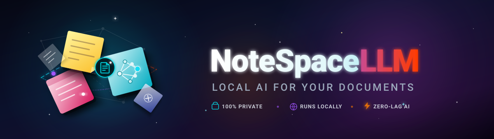

[English](README.md) · [Deutsch](README_de.md) · [Español](README_es.md) · [简体中文](README_zh.md) · [日本語](README_ja.md) · [Русский](README_ru.md)

# NoteSpaceLLM Pro

[](LICENSE)
[](https://www.python.org/)
[]()
[]()

> **Lokale NotebookLM-Alternative für private Dokumentenanalyse, RAG-gestützte Recherche und Multi-Format Berichterstellung.**

NoteSpaceLLM Pro ist Ihre private, lokale Arbeitsumgebung für strukturierte Dokumentenanalyse, intelligente Notizverwaltung und KI-gestützte Recherche. Als datenschutzfreundliche Alternative zu cloudbasierten Diensten behält NoteSpaceLLM alle Dokumente und Vektor-Indizes lokal auf Ihrem Rechner.

Die Anwendung analysiert PDF-Dateien, Word-Dokumente, Markdown, E-Mail-Exporte, Textnotizen und Forschungsordner. Sie arbeitet offline mit lokalen LLMs (z. B. via Ollama) oder über gesicherte APIs (Anthropic Claude, OpenAI). Ergebnisse lassen sich nach Markdown, PDF, DOCX, HTML und TXT exportieren. Ein leichtgewichtiger Web/PWA-Companion ermöglicht es, exportierte Workspaces offline auf Android, iOS und Browsergeräten ohne Server-Uploads zu prüfen.

## Schnellstart

```bash
git clone https://github.com/file-bricks/NoteSpaceLLM.git
cd NoteSpaceLLM
pip install -r requirements.txt
python main.py
```

Unter Windows kann die Anwendung auch über `start.bat` gestartet werden. Eine eigenständige Windows-Executable lässt sich mit `build_exe.bat` erzeugen.

Tests und Kompilierungs-Checks ausführen:

```bash
python -m pytest -q
python manage_translations.py --check
python scripts/check_store_readiness.py
python -m compileall -q main.py manage_translations.py translator.py src
```

## Hauptfunktionen

- **Dokumentenverwaltung**: Dateien und Ordner via Drag & Drop importieren
- **Automatisches Indexieren**: Neue Dokumente werden sofort für RAG-Vektorsuche aufbereitet
- **Gezielte Auswahl**: Dokumente einzeln aktivieren oder von Berichten ausschließen
- **Sub-Queries**: Gezielte Fragen an einzelne Dokumente per Rechtsklick
- **Workflow-Visualisierung**: Übersicht über die gesamte Berichtspipeline
- **Interaktiver Chat**: Kontextbezogener Dokumenten-Chat mit beliebigen Modellen
- **Deep Research**: Strukturierte Syntheseberichte und automatische Zusammenfassungen
- **Vielseitiger Export**: Ausgabe nach Markdown, PDF, DOCX, HTML und TXT
- **Prompt-Export**: Report-Kontext als Markdown-Prompt für externe KI-Workflows sichern
- **Tier-2 6-Sprachen i18n**: Benutzeroberfläche und Metadaten in DE, EN, ES, ZH, JA, RU
- **Datenschutz & Zero-Egress**: Lokale Vektordatenbank (ChromaDB), keine erzwungenen Cloud-Uploads

## Plattform-Architektur

- **Windows Desktop (PySide6)**: Primäre Arbeitsumgebung für Windows 10/11 x64
- **Windows Store (MSIX / Centros)**: Desktop Bridge Paket (`Geiger.NoteSpaceLLM`)
- **Web/PWA Companion**: Serverlose, offline-fähige Lese- und Review-App (`web_companion/`)
- **macOS / Linux**: Vollständige CLI- und Headless-Source-Smokes (`tests/platform_smoke.py`)

## Lizenz & Datenschutz

NoteSpaceLLM steht unter der **AGPL-3.0** Lizenz. Alle Analysen und Vektordaten bleiben standardmäßig vollständig auf Ihrem lokalen System gespeichert.
