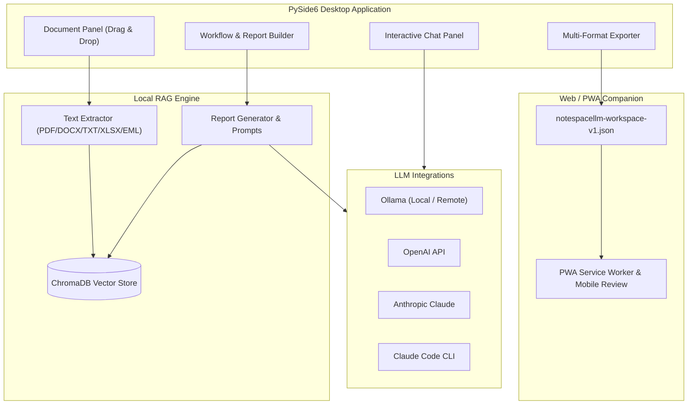

# NoteSpaceLLM

[](LICENSE)
[](https://www.python.org/)
[]()
[](https://github.com/file-bricks)
[](https://github.com/open-bricks)
[](llms.txt)

[English](README.md) | [Deutsch](README_de.md) | [Español](README_es.md) | [简体中文](README_zh.md) | [日本語](README_ja.md) | [Русский](README_ru.md) | [Français](README_fr.md) | [हिन्दी](README_hi.md) | [العربية](README_ar.md) | [বাংলা](README_bn.md) | [Português](README_pt.md)

> **Lokale Dokumenten- und Rechercheanwendung für Analysen und Berichte mit konfigurierbaren lokalen oder externen Sprachmodellen.**

> [!NOTE]
> **Für KI-Agenten und automatisierte Arbeitsabläufe:**
> NoteSpaceLLM stellt in [`llms.txt`](llms.txt) eine maschinenlesbare Architektur- und Funktionsübersicht bereit.

NoteSpaceLLM ist eine lokale PySide6-Desktopanwendung für die Arbeit mit PDFs,
Word-Dateien, Markdown, E-Mail-Exporten, Notizen und Rechercheordnern. Sie hält
Projektdaten standardmäßig lokal, unterstützt lokale oder entfernte Ollama-
Verbindungen, OpenAI, Anthropic und Claude-Code-Arbeitsabläufe und exportiert
Analyseergebnisse als Markdown, PDF, DOCX, HTML und TXT. Ein schlanker
Web/PWA-Companion ist verfügbar, um exportierte Workspaces auf Android, iOS und
im Browser zu prüfen, ohne Dokumente auf einen Server hochzuladen.

**Passende Suchbegriffe:** NotebookLM-Alternative, lokale RAG-Dokumentenanalyse,
lokaler Dokumentenchat, PySide6-Recherchewerkzeug, Berichtsgenerator mit lokalem
Modell, lokaler Dokumentenworkflow.

## Schnellstart

```bash
git clone https://github.com/file-bricks/NoteSpaceLLM.git
cd NoteSpaceLLM
pip install -r requirements.txt
python main.py
```

Unter Windows kann die Anwendung auch mit `start.bat` gestartet werden. Mit
`build_exe.bat` lässt sich ein lokaler Windows-Launcher erstellen.

Für einen ausdrücklich gestarteten, geführten lokalen Bootstrap, der die
Abhängigkeiten installiert und Startordner für Workflows und Profile anlegt,
führe `python setup_environment.py` aus. Paketmetadaten und Builds verwenden
einen separaten setuptools-Einstiegspunkt und führen dieses Skript nicht aus.

Tests und Kompilierungs-Smoke-Checks lassen sich so ausführen:

```bash
pytest
python -m compileall -q main.py manage_translations.py setup_environment.py translator.py src
cd web_companion
npm test
```

## Systemarchitektur



## Funktionen

- **Dokumentenverwaltung:** Dateien und Verzeichnisse per Drag & Drop hinzufügen
- **Automatische Extraktion und Indizierung:** Neue Dokumente werden sofort verarbeitet und für RAG vorbereitet.
- **Gezielte Analyse:** Dokumente für Berichte per Kontrollkästchen ein- oder ausschließen
- **Teilabfragen:** Ein Rechtsklick auf ein Dokument startet eine gezielte Recherche zu diesem Dokument.
- **Workflow-Visualisierung:** Grafische Übersicht über die Berichtspipeline
- **Chatoberfläche:** Interaktiver Chat mit beliebigen LLMs über die geladenen Dokumente
- **Claude-Code-Integration:** Strukturierte API-Antworten oder Übergabe an eine interaktive Claude-Code-Sitzung
- **Export in mehreren Formaten:** Ausgabe als MD, PDF, DOCX, HTML und TXT
- **Prompt-Export:** Den Berichtskontext als Markdown-Prompt für externe LLM-Arbeitsabläufe speichern
- **Ollama-Verbindungsprofile:** Appweite Provider-Einstellungen lassen sich projektübergreifend wiederverwenden
- **Sprachunterstützung:** Desktop- und Web-/PWA-Oberfläche bieten dauerhaft gespeicherte Sprachauswahlen für Englisch, Deutsch, Spanisch, vereinfachtes Chinesisch, Japanisch, Russisch, Französisch, Hindi, Arabisch, Bengalisch und Portugiesisch. Für Arabisch wird ein Rechts-nach-links-Layout verwendet. Das Sprachfeld des Projekts ist Workspace-Export-Metadatum; es ändert weder die Oberflächensprache noch legt es die Sprache generierter Berichte fest.
- **Umlautsichere Oberfläche:** Deutsche UI-Texte verwenden echte Umlaute; der Übersetzungsscanner vermeidet englische Fehlalarme.
- **Profile:** Wiederverwendbare Kombinationen von Ausgabeformaten

## Installation

```bash
# Clone or copy the project folder
cd NoteSpaceLLM

# Install dependencies
pip install -r requirements.txt

# Start the app
python main.py
```

Abhängigkeiten prüfen:

```bash
python main.py --check
```

## LLM-Konfiguration

### Ollama (lokal — empfohlen)

1. [Ollama installieren](https://ollama.ai)
2. Ein Modell herunterladen: `ollama pull llama3`
3. In der App: Menü > LLM > Ollama verwenden

### Ollama (entfernter Server)

NoteSpaceLLM kann sich mit einem entfernten Ollama-Server verbinden, zum
Beispiel über [ellmos-stack](https://github.com/ellmos-ai/ellmos-stack):

1. In der App: Menü > LLM > Einstellungen
2. **Ollama-URL:** `http://your-server:11435` (oder den verwendeten Port)
3. **API-Schlüssel:** Falls der Server hinter einem Authentifizierungs-Proxy liegt (empfohlen)

> **Tipp:** Ollama bietet keine integrierte Authentifizierung. Verwende für den
> Fernzugriff einen Reverse-Proxy (zum Beispiel Nginx) mit API-Schlüssel oder
> Basic Auth.

Der Ollama-Endpunkt und das Modell werden in den appweiten Einstellungen oder
im ausgewählten Verbindungsprofil konfiguriert, nicht pro Projekt. In der App
gespeicherte API-Schlüssel werden über den Zugangsdienst des Betriebssystems
gespeichert. Die optionale Umgebungsvariable
`NOTESPACELLM_OLLAMA_API_KEY` überschreibt den gespeicherten Schlüssel; die App
schreibt sie niemals selbst. Vorhandene Klartextschlüssel werden erst gesendet,
wenn du sie ausdrücklich in den Einstellungen migrierst.

Wenn der konfigurierte Ollama-Server entfernt läuft, erhält er Dokumenttext für
Embeddings sowie Prompts und Kontext für die Generierung. Der API-Schlüssel wird
als Bearer-Header an die konfigurierte URL gesendet. Bei reinem HTTP werden
weder Inhalte noch Zugangsdaten verschlüsselt; bei HTTPS hängt der Schutz vom
Endpunkt und dessen Zertifikat ab.

### OpenAI

```bash
export OPENAI_API_KEY="<your-openai-api-key>"
```

### Anthropic (Claude)

```bash
export ANTHROPIC_API_KEY="<your-anthropic-api-key>"
```

### Claude Code

Die lokale CLI wird benötigt:

```bash
npm install -g @anthropic-ai/claude-code
```

In der App stehen zwei Modi zur Verfügung:
- **API-Modus:** Eine strukturierte Antwort wird direkt an NoteSpaceLLM zurückgegeben.
- **Chat-Modus:** Der Prompt wird an eine interaktive Claude-Code-Konsole übergeben.

## Verwendung

### 1. Dokumente hinzufügen

- **Drag & Drop:** Dateien oder Ordner in den linken Bereich ziehen
- **Schaltflächen:** „Dateien hinzufügen“ oder „Ordner hinzufügen“

### 2. Dokumente auswählen

- Kontrollkästchen: Dokumente in die Analyse ein- oder ausschließen
- Schaltflächen: „Alle“ oder „Keine“ für die Mehrfachauswahl

### 3. Teilabfragen (optional)

Rechtsklick auf ein Dokument:
- **Zusammenfassung erstellen:** Automatische Zusammenfassung
- **Informationen extrahieren:** Bestimmte Angaben finden
- **Analysieren:** Gezielte Analyse
- **Frage stellen:** Eine konkrete Frage zum Dokument

### 4. Hauptfrage festlegen

Gib die zentrale Recherchefrage im Workflow-Bereich ein.

### 5. Workflow- oder Berichtstyp wählen

- **Analyse:** Umfassende Analyse mit Empfehlungen
- **Zusammenfassung:** Kurze Zusammenfassung
- **Recherchebericht:** Wissenschaftlicher Aufbau
- **Vergleich:** Systematischer Vergleich von Dokumenten

### 6. Bericht erstellen

Klicke auf „Bericht erstellen“ – die Ausgabe erscheint im rechten Bereich.

### 7. Exportieren

Wähle die Ausgabeformate und klicke auf „Exportieren“.

### 8. Prompt exportieren

Verwende **„Prompt exportieren“**, um den aktuellen Arbeitskontext als
Markdown-Datei für Claude Code oder andere LLM-Arbeitsabläufe zu speichern.

## Web-/PWA-Companion

Unter `web_companion/` befindet sich ein schreibgeschützter Companion für
Android, iOS und Browser. Er importiert exportierte
`notespacellm-workspace-v1.json`-Dateien lokal im Browser, zeigt den Bericht,
Dokumentenmetadaten und ausgewählte Ausschnitte an und kann Prüfnotizen als
Markdown exportieren. Der Workspace bleibt in der aktuellen Browsersitzung und
muss nach einem Neustart erneut importiert werden; nur Prüfnotizen und die
Oberflächensprache werden lokal gespeichert.

Lokaler Browser-Test:

```powershell
$env:PYTHONIOENCODING='utf-8'
python -m http.server 8765 -d web_companion
```

Companion-Smoke-Test:

```powershell
cd web_companion
node --test tests/library.test.mjs
```

Der Android-/iOS-PWA-Testplan steht in `web_companion/PWA_TESTPLAN.md`.

## Plattformstrategie

Die Desktopanwendung bietet den vollständigen Funktionsumfang für lokale
Dokumente, den RAG-Index und Provider-Verbindungen. Der Web-/PWA-Companion für
Android, iOS und Browser dient dazu, einen selbst erstellten
`notespacellm-workspace-v1.json`-Export zu prüfen. Bei sensiblen Inhalten
konfiguriere lokale Modell- und Embedding-Endpunkte und prüfe Exporte vor der
Weitergabe. Der Austauschvertrag ist in `EXPORTFORMAT.md` beschrieben.

### macOS- und Linux-Smoke-Tests aus dem Quellcode

Zusätzliche Quellcode-Smokes laufen in GitHub Actions:
- `tests/platform_smoke.py` — PySide6-Start ohne sichtbares Fenster, Dokumentimport, Berichtsexport und Workspace-JSON-Export
- `tests/linux_platform_smoke.py` — Linux-spezifischer Wrapper auf `ubuntu-latest`

## Projektstruktur

```
NoteSpaceLLM/
├── main.py                 # Entry point
├── requirements.txt        # Dependencies
├── translator.py           # Translation system and catalog scanner used by the desktop UI
├── locales/                # Catalog inputs for the translation helper
├── src/
│   ├── core/              # Core functionality
│   │   ├── document_manager.py
│   │   ├── text_extractor.py
│   │   ├── sub_query.py
│   │   └── project.py
│   ├── gui/               # PySide6 UI
│   │   ├── main_window.py
│   │   ├── document_panel.py
│   │   ├── workflow_panel.py
│   │   ├── chat_panel.py
│   │   └── output_panel.py
│   ├── llm/               # LLM integration (local + remote)
│   │   ├── client.py
│   │   ├── ollama_client.py
│   │   ├── openai_client.py
│   │   └── anthropic_client.py
│   └── reports/           # Report generation
│       ├── generator.py
│       ├── templates.py
│       └── exporter.py
├── web_companion/         # PWA Companion
├── data/                  # Project data (gitignored)
├── workflows/             # Workflow definitions
├── profiles/              # Output profiles
└── output/                # Exported reports
```

## Unterstützte Dateiformate

| Format | Lesen | Schreiben |
|--------|-------|-----------|
| PDF    | ✅    | ✅         |
| DOCX   | ✅    | ✅         |
| DOC    | ⚠️    | —         |
| TXT    | ✅    | ✅         |
| MD     | ✅    | ✅         |
| XLSX   | ✅    | —         |
| HTML   | —    | ✅         |
| EML    | ✅    | —         |
| MSG    | ✅    | —         |

⚠️ Für .doc wird antiword oder LibreOffice benötigt.

## Datenschutz

NoteSpaceLLM speichert Projektdaten, Dokumentindizes, Profile,
Workflow-Einstellungen und Exporte lokal in `data/`, `profiles/`, `workflows/`,
`output/` und `chroma_db/`. Diese Ordner sind absichtlich von Git ausgeschlossen.

Wenn externe LLM-Anbieter (OpenAI, Anthropic, Claude Code oder entferntes
Ollama) aktiviert sind, können Prompts und ausgewählte Dokumentausschnitte an
diese Dienste übertragen werden. Ein entfernter Ollama-Endpunkt erhält außerdem
Dokumenttext für Embeddings. Verwende für sensible Dokumente lokale Modell- und
Embedding-Endpunkte und prüfe exportierte Berichte, Chatverläufe und ausgewählte
Ausschnitte vor der Weitergabe; Workspace-Exporte sind nicht anonymisiert.

## Tipps

1. **Große Dokumentmengen:** Wähle zunächst nur relevante Dokumente aus, damit die Verarbeitung schneller läuft.
2. **Teilabfragen:** Gezielte Teilabfragen verbessern die Qualität der Analyse.
3. **Ollama:** Ein lokaler Ollama-Endpunkt ermöglicht die Verarbeitung ohne Internetverbindung.
4. **Workflow-Reihenfolge:** Die Schritte lassen sich im Workflow-Bereich neu anordnen.

## Lizenz

AGPL-3.0-only — siehe [LICENSE](LICENSE).

Das Projekt deklariert PySide6 und PyMuPDF. Die ausgewählten Lizenzhinweise
der Abhängigkeiten stehen in [THIRD_PARTY_LICENSES.md](THIRD_PARTY_LICENSES.md);
die Projektlizenz ist AGPL-3.0-only.

## Verwandtes Projekt

[KnowledgeDigest](https://github.com/file-bricks/KnowledgeDigest) ist eine
separate lokale Wissensdatenbank mit SQLite/FTS5-Suche und optionalen
LLM-Zusammenfassungen; sie ist nicht in NoteSpaceLLM integriert.

## Lizenz- und Wartungshinweis

Die Lizenzbedingungen des Projekts stehen in [LICENSE](LICENSE). Die
Maintainer versprechen weder fortlaufende Wartung noch dauerhafte Verfügbarkeit.
