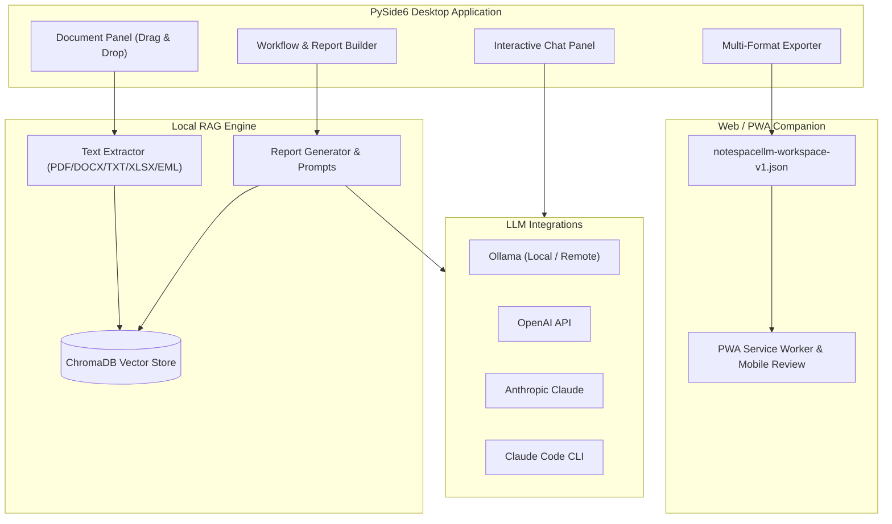

<!-- worldset: {"translated_from_sha256": "466a6a18b88506de47fa858aabc993da82eb017a6be4e93cbd9aea6ac61ec40f", "translator": "claude-haiku-5-5 with gpt-6-luna/max review and repairs", "translated_at": "2026-10-25T08:23:38.931027+00:00", "reviewer": "Root independent source/literal/encoding checks"} -->


# NoteSpaceLLM

[](LICENSE)
[](https://www.python.org/)
[]()
[](https://github.com/file-bricks)
[](https://github.com/open-bricks)
[](llms.txt)

[English](README.md) | [Deutsch](README_de.md) | [Español](README_es.md) | [简体中文](README_zh.md) | [日本語](README_ja.md) | [Русский](README_ru.md) | [Français](README_fr.md) | [हिन्दी](README_hi.md) | [العربية](README_ar.md) | [বাংলা](README_bn.md) | [Português](README_pt.md)

> **Cuaderno de documentos local-first para investigación y generación de informes con modelos de lenguaje locales o remotos configurables.**

> [!NOTE]
> **Para agentes de IA y flujos de trabajo automatizados:**
> NoteSpaceLLM proporciona una descripción de arquitectura y funcionalidades legible por máquinas en [`llms.txt`](llms.txt).

NoteSpaceLLM es una aplicación de escritorio local-first basada en PySide6 para trabajar con PDF,
archivos de Word, Markdown, exportaciones de correo, notas y carpetas de investigación. Mantiene los
datos del proyecto en local por defecto, admite flujos de trabajo con Ollama, OpenAI, Anthropic y Claude Code
locales o remotos, y exporta los resultados del análisis a Markdown,
PDF, DOCX, HTML y TXT. Ahora está disponible un Companion Web/PWA ligero para revisar
espacios de trabajo exportados en Android, iOS y dispositivos con navegador sin subir documentos a un servidor.

**Búsquedas más relevantes:** alternativa a NotebookLM, análisis de documentos RAG local,
chat de documentos local, herramienta de investigación con PySide6, generador de informes con modelos locales,
flujo de trabajo de documentos local-first.

## Inicio rápido

```bash
git clone https://github.com/file-bricks/NoteSpaceLLM.git
cd NoteSpaceLLM
pip install -r requirements.txt
python main.py
```

En Windows también puede iniciarlo mediante `start.bat`. Un lanzador local para Windows puede compilarse con `build_exe.bat`.

Para una inicialización local guiada que instala los requisitos y crea las carpetas iniciales de
flujos de trabajo y perfiles, ejecute `python setup_environment.py` de forma explícita. Los metadatos del paquete y las compilaciones
usan el punto de entrada de setuptools independiente y no lo ejecutan.

Ejecute las pruebas y las comprobaciones rápidas de compilación con:

```bash
pytest
python -m compileall -q main.py manage_translations.py setup_environment.py translator.py src
cd web_companion
npm test
```

## Arquitectura del sistema



## Funcionalidades

- **Gestión de documentos**: Añada archivos y directorios mediante arrastrar y soltar
- **Extracción e indexación automáticas**: Los nuevos documentos se procesan de inmediato y se preparan para RAG.
- **Análisis selectivo**: Marque/desmarque documentos para incluirlos o excluirlos de los informes
- **Subconsultas**: Haga clic derecho en un documento para una investigación específica de ese documento
- **Visualización del flujo de trabajo**: Vista gráfica general de la canalización de informes
- **Interfaz de chat**: Chat interactivo sobre los documentos cargados con cualquier LLM
- **Integración con Claude Code**: Respuestas de API estructuradas o traspaso a una sesión interactiva de Claude Code
- **Exportación multiformato**: Salida a MD, PDF, DOCX, HTML, TXT
- **Exportación de prompts**: Guarde el contexto del informe como prompt en Markdown para flujos de trabajo con LLM externos
- **Perfiles de conexión de Ollama**: La configuración de proveedor válida para toda la aplicación puede reutilizarse entre proyectos
- **Compatibilidad de idiomas**: La GUI de escritorio no tiene un selector de idioma para el usuario; su interfaz está actualmente principalmente en alemán. El Companion Web/PWA dispone de un selector persistente de idioma de interfaz para alemán, inglés, español, chino simplificado, japonés, ruso, francés, hindi, árabe, bengalí y portugués. El campo de idioma del proyecto se incluye en las exportaciones del espacio de trabajo; no está conectado a un selector de idioma de la interfaz de escritorio ni de los informes.
- **Interfaz compatible con los umlauts alemanes**: Los textos de la interfaz en alemán usan los caracteres originales; el escáner de traducciones evita falsos positivos en inglés
- **Perfiles**: Combinaciones reutilizables de formatos de salida

## Instalación

```bash
# Clone or copy the project folder
cd NoteSpaceLLM

# Install dependencies
pip install -r requirements.txt

# Start the app
python main.py
```

Compruebe las dependencias:

```bash
python main.py --check
```

## Configuración de LLM

### Ollama (local — recomendado)

1. [Instale Ollama](https://ollama.ai)
2. Descargue un modelo: `ollama pull llama3`
3. En la aplicación: Menú > LLM > Usar Ollama

### Ollama (servidor remoto)

NoteSpaceLLM puede conectarse a un servidor Ollama remoto, por ejemplo mediante [ellmos-stack](https://github.com/ellmos-ai/ellmos-stack):

1. En la aplicación: Menú > LLM > Configuración
2. **URL de Ollama:** `http://your-server:11435` (o su puerto)
3. **Clave API:** Si el servidor está detrás de un proxy de autenticación (recomendado)

> **Consejo:** Ollama no incluye autenticación integrada. Para el acceso remoto, use un proxy inverso (p. ej., Nginx) con clave API o autenticación básica.

El endpoint y el modelo de Ollama se configuran en la configuración válida para toda la aplicación o en el
perfil de conexión seleccionado, no por proyecto. Las claves API se almacenan mediante el almacén de credenciales
del sistema operativo cuando se guardan en la aplicación. La variable de entorno opcional
`NOTESPACELLM_OLLAMA_API_KEY` sustituye la clave guardada y
la aplicación nunca la escribe. Las claves heredadas en texto plano no se envían hasta que
las migre explícitamente en la configuración.

Cuando el servidor Ollama configurado es remoto, recibe el texto de los documentos utilizado para los embeddings y los prompts/contexto enviados para la generación. La clave API se envía a la URL configurada como cabecera Bearer. El HTTP simple no cifra ni el contenido ni las credenciales; el comportamiento de HTTPS depende del endpoint y de su certificado.

### OpenAI

```bash
export OPENAI_API_KEY="<your-openai-api-key>"
```

### Anthropic (Claude)

```bash
export ANTHROPIC_API_KEY="<your-anthropic-api-key>"
```

### Claude Code

Requiere la CLI local:

```bash
npm install -g @anthropic-ai/claude-code
```

La aplicación ofrece dos modos:
- **Modo API**: la respuesta estructurada se devuelve directamente a NoteSpaceLLM
- **Modo chat**: entrega el prompt a una consola interactiva de Claude Code

## Uso

### 1. Añadir documentos

- **Arrastrar y soltar**: suelte archivos o carpetas en el panel izquierdo
- **Botón**: "Add files" o "Add folder"

### 2. Seleccionar documentos

- Casilla: incluye/excluye documentos para el análisis
- Botones: "All" / "None" para la selección masiva

### 3. Subconsultas (opcional)

Haga clic derecho en un documento:
- **Create summary**: resumen automático
- **Extract information**: buscar datos específicos
- **Analyse**: análisis dirigido
- **Ask question**: pregunta específica sobre el documento

### 4. Definir la pregunta principal

Introduzca la pregunta central de investigación en el panel de flujo de trabajo.

### 5. Elegir el tipo de flujo de trabajo/informe

- **Analysis**: análisis exhaustivo con recomendaciones
- **Summary**: resumen breve
- **Research report**: estructura académica
- **Comparison**: comparación sistemática de documentos

### 6. Generar el informe

Haga clic en "Create report"; la salida aparece en el panel derecho.

### 7. Exportar

Seleccione los formatos de salida y haga clic en "Export".

### 8. Exportar el prompt

Use **"Export prompt"** para guardar el contexto de trabajo actual como archivo Markdown para usarlo en Claude Code u otros flujos de trabajo con LLM.

## Compañero Web/PWA

Bajo `web_companion/` se encuentra un compañero de solo lectura para Android, iOS y navegador. Importa archivos `notespacellm-workspace-v1.json` exportados de forma local en el navegador, muestra el informe, los metadatos de los documentos y los fragmentos seleccionados, y puede exportar notas de revisión en Markdown. El espacio de trabajo permanece en la sesión actual del navegador y debe volver a importarse tras reabrirlo; solo las notas de revisión y el idioma de la interfaz se guardan localmente.

Prueba local en el navegador:

```powershell
$env:PYTHONIOENCODING='utf-8'
python -m http.server 8765 -d web_companion
```

Pruebas rápidas del compañero:

```powershell
cd web_companion
node --test tests/library.test.mjs
```

El plan de pruebas de la PWA para Android/iOS está documentado en `web_companion/PWA_TESTPLAN.md`.

## Estrategia de plataforma

La aplicación de escritorio es la aplicación completa para documentos locales, el índice RAG y las conexiones con proveedores. El compañero Web/PWA para Android, iOS y navegador está disponible para revisar una exportación `notespacellm-workspace-v1.json` creada por el usuario. Para material sensible, configure endpoints locales de modelo y embeddings, y revise las exportaciones antes de compartirlas. El contrato de intercambio está documentado en `EXPORTFORMAT.md`.

### Pruebas rápidas de código fuente en macOS y Linux

Pruebas rápidas adicionales se ejecutan en GitHub Actions:
- `tests/platform_smoke.py` — inicio sin pantalla de PySide6, importación de documentos, exportación de informes, exportación de JSON del espacio de trabajo
- `tests/linux_platform_smoke.py` — envoltorio específico de Linux sobre `ubuntu-latest`

## Estructura del proyecto

```
NoteSpaceLLM/
├── main.py                 # Entry point
├── requirements.txt        # Dependencies
├── translator.py           # Translation-catalog scan/helper; no desktop language switch
├── locales/                # Catalog inputs for the translation helper
├── src/
│   ├── core/              # Core functionality
│   │   ├── document_manager.py
│   │   ├── text_extractor.py
│   │   ├── sub_query.py
│   │   └── project.py
│   ├── gui/               # PySide6 UI
│   │   ├── main_window.py
│   │   ├── document_panel.py
│   │   ├── workflow_panel.py
│   │   ├── chat_panel.py
│   │   └── output_panel.py
│   ├── llm/               # LLM integration (local + remote)
│   │   ├── client.py
│   │   ├── ollama_client.py
│   │   ├── openai_client.py
│   │   └── anthropic_client.py
│   └── reports/           # Report generation
│       ├── generator.py
│       ├── templates.py
│       └── exporter.py
├── web_companion/         # PWA Companion
├── data/                  # Project data (gitignored)
├── workflows/             # Workflow definitions
├── profiles/              # Output profiles
└── output/                # Exported reports
```

## Formatos de archivo compatibles

| Formato | Lectura | Escritura |
|--------|------|-------|
| PDF    | ✅   | ✅    |
| DOCX   | ✅   | ✅    |
| DOC    | ⚠️   | —     |
| TXT    | ✅   | ✅    |
| MD     | ✅   | ✅    |
| XLSX   | ✅   | —     |
| HTML   | —    | ✅    |
| EML    | ✅   | —     |
| MSG    | ✅   | —     |

⚠️ .doc requiere antiword o LibreOffice

## Privacidad

NoteSpaceLLM almacena localmente los datos de proyectos, los índices de documentos, los perfiles, la configuración de flujos de trabajo y las exportaciones en `data/`, `profiles/`, `workflows/`, `output/` y `chroma_db/`. Estas carpetas se excluyen intencionadamente de Git.

Cuando se habilitan proveedores externos de LLM (OpenAI, Anthropic, Claude Code, Ollama remoto), los prompts y los fragmentos de documentos seleccionados pueden transmitirse a esos servicios. Un endpoint remoto de Ollama también recibe el texto de los documentos utilizado para los embeddings. Para documentos sensibles, use endpoints locales de modelo y embeddings, y revise los informes exportados, el historial de chat y los fragmentos seleccionados antes de compartirlos; las exportaciones del espacio de trabajo no están anonimizadas.

## Consejos

1. **Conjuntos grandes de documentos**: seleccione primero solo los documentos relevantes para obtener resultados más rápidos
2. **Subconsultas**: use subconsultas dirigidas para un análisis de mayor calidad
3. **Ollama**: un endpoint local de Ollama permite el procesamiento sin conexión
4. **Orden del flujo de trabajo**: los pasos pueden reordenarse en el panel de flujo de trabajo

## Licencia

AGPL-3.0-only — véase [LICENSE](LICENSE)

Este proyecto declara PySide6 y PyMuPDF. Consulte las referencias de licencia upstream seleccionadas en [THIRD_PARTY_LICENSES.md](THIRD_PARTY_LICENSES.md); la licencia propia del proyecto es AGPL-3.0-only.

## Proyecto relacionado

[KnowledgeDigest](https://github.com/file-bricks/KnowledgeDigest) es una base de conocimiento local separada con búsqueda SQLite/FTS5 y resúmenes opcionales con LLM; no está integrada con NoteSpaceLLM.

## Aviso de licencia y mantenimiento

Consulte [LICENSE](LICENSE) para los términos de licencia del proyecto. Los mantenedores no prometen mantenimiento ni disponibilidad continuos.
