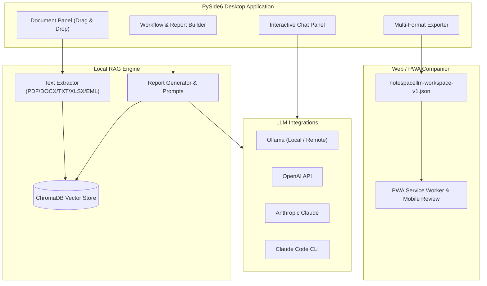

<!-- worldset: {"translated_from_sha256": "466a6a18b88506de47fa858aabc993da82eb017a6be4e93cbd9aea6ac61ec40f", "translator": "claude-haiku-5-5 with gpt-6-luna/max review and repairs", "translated_at": "2026-10-25T08:23:39.693724+00:00", "reviewer": "Root independent source/literal/encoding checks"} -->


# NoteSpaceLLM

[](LICENSE)
[](https://www.python.org/)
[]()
[](https://github.com/file-bricks)
[](https://github.com/open-bricks)
[](llms.txt)

[English](README.md) | [Deutsch](README_de.md) | [Español](README_es.md) | [简体中文](README_zh.md) | [日本語](README_ja.md) | [Русский](README_ru.md) | [Français](README_fr.md) | [हिन्दी](README_hi.md) | [العربية](README_ar.md) | [বাংলা](README_bn.md) | [Português](README_pt.md)

> **Carnet documentaire privilégiant le stockage local pour la recherche et la génération de rapports, avec des modèles de langage configurables, exécutés localement ou à distance.**

> [!NOTE]
> **Pour les agents IA et les flux de travail automatisés :**
> NoteSpaceLLM fournit une présentation de l'architecture et des fonctionnalités lisible par machine dans [`llms.txt`](llms.txt).

NoteSpaceLLM est une application de bureau PySide6 qui privilégie le traitement local et permet de travailler avec des PDF,
des fichiers Word, du Markdown, des exports de messagerie, des notes et des dossiers de recherche. Elle conserve
les données de projet localement par défaut, prend en charge les flux de travail Ollama locaux ou distants, OpenAI,
Anthropic et Claude Code, et exporte les résultats d'analyse en Markdown,
PDF, DOCX, HTML et TXT. Un Companion Web/PWA léger est désormais disponible pour
consulter les espaces de travail exportés sur Android, iOS et les appareils équipés d'un navigateur, sans
téléverser de documents sur un serveur.

**Recherches les plus pertinentes :** alternative à NotebookLM, analyse de documents RAG locale,
conversation locale avec des documents, outil de recherche PySide6, générateur de rapports reposant sur un modèle local,
flux de travail documentaire privilégiant le local.

## Démarrage rapide

```bash
git clone https://github.com/file-bricks/NoteSpaceLLM.git
cd NoteSpaceLLM
pip install -r requirements.txt
python main.py
```

Sous Windows, vous pouvez également lancer l'application via `start.bat`. Un lanceur Windows local peut être créé avec `build_exe.bat`.

Pour une initialisation locale guidée qui installe les dépendances et crée les dossiers de départ
des flux de travail et des profils, exécutez explicitement `python setup_environment.py`. Les métadonnées du paquet et les
builds utilisent le point d'entrée setuptools distinct et ne l'exécutent pas.

Exécutez les tests et les vérifications de compilation rapides avec :

```bash
pytest
python -m compileall -q main.py manage_translations.py setup_environment.py translator.py src
cd web_companion
npm test
```

## Architecture du système



## Fonctionnalités

- **Gestion des documents** : ajoutez des fichiers et des dossiers par glisser-déposer
- **Extraction et indexation automatiques** : les nouveaux documents sont traités immédiatement et préparés pour le RAG.
- **Analyse sélective** : cochez/décochez les documents à inclure ou exclure des rapports
- **Sous-requêtes** : faites un clic droit sur un document pour une recherche ciblée sur ce document
- **Visualisation du flux de travail** : vue graphique du pipeline de rapport
- **Interface de discussion** : discussion interactive sur les documents chargés avec n'importe quel LLM
- **Intégration de Claude Code** : réponses d'API structurées ou transmission à une session Claude Code interactive
- **Export multi-format** : sortie en MD, PDF, DOCX, HTML, TXT
- **Export de prompt** : enregistrez le contexte du rapport sous forme de prompt Markdown pour des flux de travail LLM externes
- **Profils de connexion Ollama** : les paramètres de fournisseur à l'échelle de l'application peuvent être réutilisés d'un projet à l'autre
- **Prise en charge des langues** : l'interface graphique de bureau n'a pas de sélecteur de langue accessible à l'utilisateur ; son interface est actuellement principalement en allemand. Le Companion Web/PWA dispose d'un sélecteur persistant de langue d'interface pour l'allemand, l'anglais, l'espagnol, le chinois simplifié, le japonais, le russe, le français, l’hindi, l’arabe, le bengali et le portugais. Le champ de langue du projet est inclus dans les exports d'espace de travail ; il n'est pas relié à un sélecteur de langue de bureau ou de rapport.
- **Interface compatible avec les umlauts** : les chaînes de l'interface allemande utilisent les umlauts natifs ; le scanner de traduction évite les faux positifs en anglais
- **Profils** : combinaisons réutilisables de formats de sortie

## Installation

```bash
# Clone or copy the project folder
cd NoteSpaceLLM

# Install dependencies
pip install -r requirements.txt

# Start the app
python main.py
```

Vérifiez les dépendances :

```bash
python main.py --check
```

## Configuration des LLM

### Ollama (local — recommandé)

1. [Installez Ollama](https://ollama.ai)
2. Téléchargez un modèle : `ollama pull llama3`
3. Dans l'application : Menu > LLM > Utiliser Ollama

### Ollama (serveur distant)

NoteSpaceLLM peut se connecter à un serveur Ollama distant, par exemple via [ellmos-stack](https://github.com/ellmos-ai/ellmos-stack) :

1. Dans l'application : Menu > LLM > Paramètres
2. **URL Ollama :** `http://your-server:11435` (ou votre port)
3. **Clé API :** à renseigner si le serveur se trouve derrière un proxy d'authentification (recommandé)

> **Astuce :** Ollama ne dispose pas d'authentification intégrée. Pour un accès distant, utilisez un proxy inverse (par exemple Nginx) avec une clé API ou une authentification Basic.

Le point de terminaison Ollama et le modèle se configurent dans les paramètres à l'échelle de l'application ou
dans le profil de connexion sélectionné, et non par projet. Les clés API sont stockées via le
gestionnaire d'identifiants du système d'exploitation lorsqu'elles sont enregistrées dans l'application. La variable d'environnement
facultative `NOTESPACELLM_OLLAMA_API_KEY` remplace la clé enregistrée et n'est jamais écrite par
l'application. Les clés héritées en clair ne sont pas envoyées tant que vous ne les migrez pas explicitement
dans les paramètres.

Lorsque le serveur Ollama configuré est distant, il reçoit le texte des documents utilisé pour les embeddings, ainsi que les prompts et le contexte transmis pour la génération. La clé API est envoyée à l’URL configurée dans un en-tête Bearer. HTTP en clair ne chiffre ni le contenu ni les identifiants ; le comportement de HTTPS dépend du point de terminaison et de son certificat.

### OpenAI

```bash
export OPENAI_API_KEY="<your-openai-api-key>"
```

### Anthropic (Claude)

```bash
export ANTHROPIC_API_KEY="<your-anthropic-api-key>"
```

### Claude Code

La CLI locale est requise :

```bash
npm install -g @anthropic-ai/claude-code
```

Deux modes sont disponibles dans l’application :
- **Mode API** : la réponse structurée est renvoyée directement dans NoteSpaceLLM
- **Mode chat** : le prompt est transmis à une console Claude Code interactive

## Utilisation

### 1. Ajouter des documents

- **Glisser-déposer** : déposez des fichiers ou des dossiers dans le panneau de gauche
- **Bouton** : « Ajouter des fichiers » ou « Ajouter un dossier »

### 2. Sélectionner des documents

- Case à cocher : inclure ou exclure des documents de l’analyse
- Boutons : « Tout » / « Aucun » pour la sélection groupée

### 3. Sous-requêtes (facultatif)

Faites un clic droit sur un document :
- **Créer un résumé** : résumé automatique
- **Extraire des informations** : rechercher des données précises
- **Analyser** : analyse ciblée
- **Poser une question** : question précise sur le document

### 4. Définir la question principale

Saisissez la question de recherche centrale dans le panneau de flux de travail.

### 5. Choisir le type de flux de travail ou de rapport

- **Analyse** : analyse complète avec recommandations
- **Résumé** : résumé court
- **Rapport de recherche** : structure académique
- **Comparaison** : comparaison systématique de documents

### 6. Générer le rapport

Cliquez sur « Créer le rapport » ; le résultat apparaît dans le panneau de droite.

### 7. Exporter

Sélectionnez les formats de sortie et cliquez sur « Exporter ».

### 8. Exporter le prompt

Utilisez **« Exporter le prompt »** pour enregistrer le contexte de travail actuel dans un fichier Markdown à utiliser dans Claude Code ou d’autres flux de travail LLM.

## Compagnon Web/PWA

Le dossier `web_companion/` contient une application compagnon en lecture seule pour Android, iOS et les navigateurs. Elle importe localement dans le navigateur les fichiers `notespacellm-workspace-v1.json` exportés, affiche le rapport, les métadonnées des documents et les extraits sélectionnés, et peut exporter des notes de relecture en Markdown. L’espace de travail reste dans la session actuelle du navigateur et doit être importé de nouveau après sa réouverture ; seules les notes de relecture et la langue de l’interface sont enregistrées localement.

Test du navigateur en local :

```powershell
$env:PYTHONIOENCODING='utf-8'
python -m http.server 8765 -d web_companion
```

Tests rapides du Companion :

```powershell
cd web_companion
node --test tests/library.test.mjs
```

Le plan de test PWA pour Android/iOS est décrit dans `web_companion/PWA_TESTPLAN.md`.

## Stratégie de plateforme

L’application de bureau est l’application complète pour les documents locaux, l’index RAG et les connexions aux fournisseurs. Le compagnon Web/PWA pour Android, iOS et navigateur permet de consulter un export `notespacellm-workspace-v1.json` créé par l’utilisateur. Pour les données sensibles, configurez des points de terminaison locaux pour les modèles et les embeddings, puis relisez les exports avant de les partager. Le contrat d’échange est décrit dans `EXPORTFORMAT.md`.

### Tests rapides du code source sur macOS et Linux

D’autres tests rapides du code source s’exécutent dans GitHub Actions :
- `tests/platform_smoke.py` — démarrage de PySide6 sans affichage, import de documents, export de rapport et export JSON de l’espace de travail
- `tests/linux_platform_smoke.py` — enveloppe spécifique à Linux exécutée sur `ubuntu-latest`

## Structure du projet

```
NoteSpaceLLM/
├── main.py                 # Entry point
├── requirements.txt        # Dependencies
├── translator.py           # Translation-catalog scan/helper; no desktop language switch
├── locales/                # Catalog inputs for the translation helper
├── src/
│   ├── core/              # Core functionality
│   │   ├── document_manager.py
│   │   ├── text_extractor.py
│   │   ├── sub_query.py
│   │   └── project.py
│   ├── gui/               # PySide6 UI
│   │   ├── main_window.py
│   │   ├── document_panel.py
│   │   ├── workflow_panel.py
│   │   ├── chat_panel.py
│   │   └── output_panel.py
│   ├── llm/               # LLM integration (local + remote)
│   │   ├── client.py
│   │   ├── ollama_client.py
│   │   ├── openai_client.py
│   │   └── anthropic_client.py
│   └── reports/           # Report generation
│       ├── generator.py
│       ├── templates.py
│       └── exporter.py
├── web_companion/         # PWA Companion
├── data/                  # Project data (gitignored)
├── workflows/             # Workflow definitions
├── profiles/              # Output profiles
└── output/                # Exported reports
```

## Formats de fichiers pris en charge

| Format | Lecture | Écriture |
|--------|---------|----------|
| PDF    | ✅      | ✅       |
| DOCX   | ✅      | ✅       |
| DOC    | ⚠️      | —        |
| TXT    | ✅      | ✅       |
| MD     | ✅      | ✅       |
| XLSX   | ✅      | —        |
| HTML   | —       | ✅       |
| EML    | ✅      | —        |
| MSG    | ✅      | —        |

⚠️ Le format .doc nécessite antiword ou LibreOffice.

## Confidentialité

NoteSpaceLLM stocke localement les données des projets, les index de documents, les profils, les paramètres de flux de travail et les exports dans `data/`, `profiles/`, `workflows/`, `output/` et `chroma_db/`. Ces dossiers sont volontairement exclus de Git.

Lorsque des fournisseurs LLM externes (OpenAI, Anthropic, Claude Code, Ollama distant) sont activés, les prompts et les extraits de documents sélectionnés peuvent leur être transmis. Un point de terminaison Ollama distant reçoit également le texte des documents utilisé pour les embeddings. Pour les documents sensibles, utilisez des points de terminaison locaux pour les modèles et les embeddings et relisez les rapports exportés, l’historique de discussion et les extraits sélectionnés avant de les partager ; les exports d’espace de travail ne sont pas anonymisés.

## Conseils

1. **Grands ensembles de documents** : sélectionnez d’abord uniquement les documents pertinents pour accélérer le traitement
2. **Sous-requêtes** : utilisez des sous-requêtes ciblées pour obtenir une analyse de meilleure qualité
3. **Ollama** : un point de terminaison Ollama local permet un traitement hors ligne.
4. **Ordre du flux de travail** : les étapes peuvent être réorganisées dans le panneau de flux de travail

## Licence

AGPL-3.0-only — voir [LICENSE](LICENSE)

Le projet déclare utiliser PySide6 et PyMuPDF. Les références aux licences amont sélectionnées figurent dans [THIRD_PARTY_LICENSES.md](THIRD_PARTY_LICENSES.md) ; la licence propre au projet est AGPL-3.0-only.

## Projet associé

[KnowledgeDigest](https://github.com/file-bricks/KnowledgeDigest) est une base de connaissances locale distincte, avec une recherche SQLite/FTS5 et des résumés LLM facultatifs ; elle n’est pas intégrée à NoteSpaceLLM.

## Avis de licence et de maintenance

Consultez [LICENSE](LICENSE) pour les conditions de licence du projet. Les mainteneurs ne garantissent ni maintenance continue ni disponibilité.
