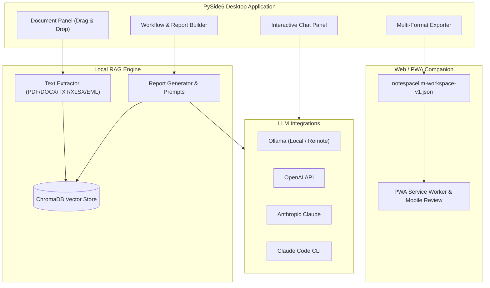

<!-- worldset: {"translated_from_sha256": "466a6a18b88506de47fa858aabc993da82eb017a6be4e93cbd9aea6ac61ec40f", "translator": "claude-haiku-5-5 with gpt-6-luna/max review and repairs", "translated_at": "2026-10-25T08:23:40.327891+00:00", "reviewer": "Root independent source/literal/encoding checks"} -->


# NoteSpaceLLM

[](LICENSE)
[](https://www.python.org/)
[]()
[](https://github.com/file-bricks)
[](https://github.com/open-bricks)
[](llms.txt)

[English](README.md) | [Deutsch](README_de.md) | [Español](README_es.md) | [简体中文](README_zh.md) | [日本語](README_ja.md) | [Русский](README_ru.md) | [Français](README_fr.md) | [हिन्दी](README_hi.md) | [العربية](README_ar.md) | [বাংলা](README_bn.md) | [Português](README_pt.md)

> **शोध और रिपोर्ट निर्माण के लिए स्थानीय-प्रथम दस्तावेज़ नोटबुक, जिसमें कॉन्फ़िगर करने योग्य स्थानीय या दूरस्थ भाषा मॉडल हैं।**

> [!NOTE]
> **AI एजेंट्स और स्वचालित वर्कफ़्लो के लिए:**
> NoteSpaceLLM [`llms.txt`](llms.txt) में मशीन-पठनीय आर्किटेक्चर और फ़ीचर अवलोकन प्रदान करता है।

NoteSpaceLLM एक स्थानीय-प्रथम PySide6 डेस्कटॉप ऐप है जो PDF,
Word फ़ाइलों, Markdown, मेल एक्सपोर्ट, नोट्स और शोध फ़ोल्डरों के साथ काम करने के लिए है। यह डिफ़ॉल्ट रूप से
प्रोजेक्ट डेटा को स्थानीय रखता है, स्थानीय या दूरस्थ Ollama, OpenAI,
Anthropic और Claude Code वर्कफ़्लो का समर्थन करता है, और विश्लेषण परिणामों को Markdown,
PDF, DOCX, HTML और TXT में एक्सपोर्ट करता है। एक हल्का Web/PWA Companion अब उपलब्ध है, जिससे
Android, iOS और ब्राउज़र डिवाइसों पर एक्सपोर्ट किए गए वर्कस्पेस की समीक्षा की जा सकती है, बिना दस्तावेज़ों को सर्वर पर अपलोड किए।

**सर्वोत्तम-मेल खोजें:** NotebookLM विकल्प, स्थानीय RAG दस्तावेज़ विश्लेषण,
स्थानीय दस्तावेज़ चैट, PySide6 शोध उपकरण, स्थानीय-मॉडल रिपोर्ट जनरेटर,
स्थानीय-प्रथम दस्तावेज़ वर्कफ़्लो।

## त्वरित प्रारंभ

```bash
git clone https://github.com/file-bricks/NoteSpaceLLM.git
cd NoteSpaceLLM
pip install -r requirements.txt
python main.py
```

Windows पर आप `start.bat` के माध्यम से भी लॉन्च कर सकते हैं। `build_exe.bat` के साथ एक स्थानीय Windows लॉन्चर बनाया जा सकता है।

आवश्यकताएँ इंस्टॉल करने और स्टार्टर वर्कफ़्लो/प्रोफ़ाइल फ़ोल्डर बनाने वाले निर्देशित स्थानीय बूटस्ट्रैप के लिए, `python setup_environment.py` को स्पष्ट रूप से चलाएँ। पैकेज मेटाडेटा और बिल्ड अलग setuptools एंट्री पॉइंट का उपयोग करते हैं और उसे नहीं चलाते।

टेस्ट चलाने और कंपाइल स्मोक चेक के लिए:

```bash
pytest
python -m compileall -q main.py manage_translations.py setup_environment.py translator.py src
cd web_companion
npm test
```

## सिस्टम आर्किटेक्चर



## फ़ीचर

- **दस्तावेज़ प्रबंधन**: ड्रैग और ड्रॉप के माध्यम से फ़ाइलें और डायरेक्टरी जोड़ें
- **स्वचालित निष्कर्षण और इंडेक्सिंग**: नए दस्तावेज़ तुरंत संसाधित होते हैं और RAG के लिए तैयार किए जाते हैं।
- **चयनात्मक विश्लेषण**: रिपोर्ट में शामिल या बाहर रखने के लिए दस्तावेज़ों को चेक/अनचेक करें
- **उप-क्वेरी**: लक्षित दस्तावेज़-विशिष्ट शोध के लिए किसी दस्तावेज़ पर राइट-क्लिक करें
- **वर्कफ़्लो विज़ुअलाइज़ेशन**: रिपोर्ट पाइपलाइन का ग्राफ़िकल अवलोकन
- **चैट इंटरफ़ेस**: किसी भी LLM के साथ लोड किए गए दस्तावेज़ों पर इंटरैक्टिव चैट
- **Claude Code एकीकरण**: संरचित API प्रतिक्रियाएँ या इंटरैक्टिव Claude Code सत्र में हैंड-ऑफ़
- **मल्टी-फ़ॉर्मेट एक्सपोर्ट**: MD, PDF, DOCX, HTML, TXT में आउटपुट
- **प्रॉम्प्ट एक्सपोर्ट**: बाहरी LLM वर्कफ़्लो के लिए रिपोर्ट संदर्भ को Markdown प्रॉम्प्ट के रूप में सहेजें
- **Ollama कनेक्शन प्रोफ़ाइल**: ऐप-व्यापी प्रदाता सेटिंग्स को प्रोजेक्ट्स में पुनः उपयोग किया जा सकता है
- **भाषा समर्थन**: डेस्कटॉप GUI में उपयोगकर्ता-चयन योग्य कोई भाषा नहीं है; इसका इंटरफ़ेस वर्तमान में मुख्यतः जर्मन है। Web/PWA Companion में जर्मन, अंग्रेज़ी, स्पैनिश, सरलीकृत चीनी, जापानी, रूसी, फ़्रेंच, हिंदी, अरबी, बंगाली और पुर्तगाली के लिए एक स्थायी UI-भाषा चयनकर्ता है। प्रोजेक्ट भाषा फ़ील्ड वर्कस्पेस एक्सपोर्ट में शामिल है; यह डेस्कटॉप UI या रिपोर्ट-भाषा चयनकर्ता से जुड़ा नहीं है।
- **Umlaut-सुरक्षित UI**: जर्मन UI स्ट्रिंग्स मूल umlauts का उपयोग करती हैं; अनुवाद स्कैनर अंग्रेज़ी के गलत सकारात्मक परिणामों से बचता है
- **प्रोफ़ाइल**: पुन: उपयोग योग्य आउटपुट-फ़ॉर्मेट संयोजन

## इंस्टॉलेशन

```bash
# Clone or copy the project folder
cd NoteSpaceLLM

# Install dependencies
pip install -r requirements.txt

# Start the app
python main.py
```

निर्भरताएँ जाँचें:

```bash
python main.py --check
```

## LLM कॉन्फ़िगरेशन

### Ollama (स्थानीय — अनुशंसित)

1. [Ollama इंस्टॉल करें](https://ollama.ai)
2. एक मॉडल डाउनलोड करें: `ollama pull llama3`
3. ऐप में: Menu > LLM > Use Ollama

### Ollama (दूरस्थ सर्वर)

NoteSpaceLLM एक दूरस्थ Ollama सर्वर से कनेक्ट हो सकता है, उदाहरण के लिए [ellmos-stack](https://github.com/ellmos-ai/ellmos-stack) के माध्यम से:

1. ऐप में: Menu > LLM > Settings
2. **Ollama URL:** `http://your-server:11435` (या आपका पोर्ट)
3. **API Key:** यदि सर्वर किसी auth proxy के पीछे है (अनुशंसित)

> **सुझाव:** Ollama में अंतर्निर्मित प्रमाणीकरण नहीं है। दूरस्थ पहुँच के लिए API key या Basic Auth के साथ रिवर्स प्रॉक्सी (जैसे Nginx) का उपयोग करें।

Ollama endpoint और मॉडल ऐप-व्यापी सेटिंग्स या चयनित कनेक्शन प्रोफ़ाइल में
कॉन्फ़िगर होते हैं, प्रति प्रोजेक्ट नहीं। ऐप में सहेजे जाने पर API keys ऑपरेटिंग सिस्टम के
credential store के माध्यम से संग्रहीत होती हैं। वैकल्पिक
`NOTESPACELLM_OLLAMA_API_KEY` environment variable सहेजी गई key को ओवरराइड करता है और
ऐप द्वारा कभी लिखा नहीं जाता। Legacy plaintext keys तब तक नहीं भेजी जातीं जब तक आप
सेटिंग्स में उन्हें स्पष्ट रूप से माइग्रेट नहीं करते।

जब कॉन्फ़िगर किया गया Ollama सर्वर रिमोट होता है, तो वह एम्बेडिंग के लिए उपयोग किया जाने वाला दस्तावेज़ टेक्स्ट और जेनरेशन के लिए भेजे गए prompts/context प्राप्त करता है। API key को Bearer header के रूप में कॉन्फ़िगर किए गए URL पर भेजा जाता है। सादा HTTP न तो सामग्री को और न ही क्रेडेंशियल्स को एन्क्रिप्ट करता है; HTTPS का व्यवहार endpoint और उसके certificate पर निर्भर करता है।

### OpenAI

```bash
export OPENAI_API_KEY="<your-openai-api-key>"
```

### Anthropic (Claude)

```bash
export ANTHROPIC_API_KEY="<your-anthropic-api-key>"
```

### Claude Code

इसके लिए स्थानीय CLI आवश्यक है:

```bash
npm install -g @anthropic-ai/claude-code
```

ऐप में दो मोड उपलब्ध हैं:
- **API मोड**: संरचित प्रतिक्रिया सीधे NoteSpaceLLM में लौटाई जाती है
- **Chat मोड**: prompt को एक इंटरैक्टिव Claude Code console को सौंप देता है

## उपयोग

### 1. दस्तावेज़ जोड़ें

- **Drag & Drop**: फ़ाइलें या फ़ोल्डर बाएँ पैनल में छोड़ें
- **बटन**: "Add files" या "Add folder"

### 2. दस्तावेज़ चुनें

- Checkbox: विश्लेषण के लिए दस्तावेज़ों को शामिल/बाहर करें
- बटन: बल्क चयन के लिए "All" / "None"

### 3. Sub-queries (वैकल्पिक)

किसी दस्तावेज़ पर राइट-क्लिक करें:
- **Create summary**: स्वचालित सारांश
- **Extract information**: विशिष्ट डेटा खोजें
- **Analyse**: लक्षित विश्लेषण
- **Ask question**: दस्तावेज़ के बारे में विशिष्ट प्रश्न

### 4. मुख्य प्रश्न परिभाषित करें

workflow पैनल में केंद्रीय शोध प्रश्न दर्ज करें।

### 5. Workflow/रिपोर्ट प्रकार चुनें

- **Analysis**: सिफारिशों के साथ व्यापक विश्लेषण
- **Summary**: संक्षिप्त सारांश
- **Research report**: शैक्षणिक संरचना
- **Comparison**: व्यवस्थित दस्तावेज़ तुलना

### 6. रिपोर्ट बनाएँ

"Create report" पर क्लिक करें — आउटपुट दाएँ पैनल में दिखाई देगा।

### 7. एक्सपोर्ट

आउटपुट फ़ॉर्मेट चुनें और "Export" पर क्लिक करें।

### 8. Prompt एक्सपोर्ट

वर्तमान कार्यशील context को Claude Code या अन्य LLM workflows में उपयोग के लिए Markdown फ़ाइल के रूप में सहेजने हेतु **"Export prompt"** का उपयोग करें।

## Web/PWA Companion

`web_companion/` के अंतर्गत Android, iOS और browser के लिए एक केवल-पढ़ने योग्य Companion strand है। यह browser में स्थानीय रूप से निर्यात किए गए `notespacellm-workspace-v1.json` फ़ाइलों को आयात करता है, रिपोर्ट, दस्तावेज़ मेटाडेटा और चयनित अंश दिखाता है, और समीक्षा नोट्स को Markdown के रूप में एक्सपोर्ट कर सकता है। workspace वर्तमान browser session में रहता है और ब्राउज़र दोबारा खोलने के बाद फिर से आयात करना होगा; केवल समीक्षा नोट्स और UI locale स्थानीय रूप से सहेजे जाते हैं।

स्थानीय browser परीक्षण:

```powershell
$env:PYTHONIOENCODING='utf-8'
python -m http.server 8765 -d web_companion
```

Companion smokes:

```powershell
cd web_companion
node --test tests/library.test.mjs
```

Android/iOS PWA परीक्षण योजना `web_companion/PWA_TESTPLAN.md` में दस्तावेज़ित है।

## प्लेटफ़ॉर्म रणनीति

डेस्कटॉप ऐप स्थानीय दस्तावेज़ों, RAG index और provider कनेक्शनों के लिए पूर्ण एप्लिकेशन है। Android, iOS और browser Web/PWA Companion उपयोगकर्ता द्वारा बनाए गए `notespacellm-workspace-v1.json` एक्सपोर्ट की समीक्षा के लिए उपलब्ध है। संवेदनशील सामग्री के लिए, स्थानीय model और embedding endpoints कॉन्फ़िगर करें और साझा करने से पहले एक्सपोर्ट की समीक्षा करें। विनिमय अनुबंध `EXPORTFORMAT.md` में दस्तावेज़ित है।

### macOS और Linux Source Smokes

GitHub Actions में अतिरिक्त source smokes चलते हैं:
- `tests/platform_smoke.py` — offscreen PySide6 start, दस्तावेज़ आयात, रिपोर्ट एक्सपोर्ट, workspace JSON एक्सपोर्ट
- `tests/linux_platform_smoke.py` — `ubuntu-latest` के ऊपर Linux-विशिष्ट wrapper

## प्रोजेक्ट संरचना

```
NoteSpaceLLM/
├── main.py                 # Entry point
├── requirements.txt        # Dependencies
├── translator.py           # Translation-catalog scan/helper; no desktop language switch
├── locales/                # Catalog inputs for the translation helper
├── src/
│   ├── core/              # Core functionality
│   │   ├── document_manager.py
│   │   ├── text_extractor.py
│   │   ├── sub_query.py
│   │   └── project.py
│   ├── gui/               # PySide6 UI
│   │   ├── main_window.py
│   │   ├── document_panel.py
│   │   ├── workflow_panel.py
│   │   ├── chat_panel.py
│   │   └── output_panel.py
│   ├── llm/               # LLM integration (local + remote)
│   │   ├── client.py
│   │   ├── ollama_client.py
│   │   ├── openai_client.py
│   │   └── anthropic_client.py
│   └── reports/           # Report generation
│       ├── generator.py
│       ├── templates.py
│       └── exporter.py
├── web_companion/         # PWA Companion
├── data/                  # Project data (gitignored)
├── workflows/             # Workflow definitions
├── profiles/              # Output profiles
└── output/                # Exported reports
```

## समर्थित फ़ाइल फ़ॉर्मेट

| फ़ॉर्मेट | पढ़ना | लिखना |
|--------|------|-------|
| PDF    | ✅   | ✅    |
| DOCX   | ✅   | ✅    |
| DOC    | ⚠️   | —     |
| TXT    | ✅   | ✅    |
| MD     | ✅   | ✅    |
| XLSX   | ✅   | —     |
| HTML   | —    | ✅    |
| EML    | ✅   | —     |
| MSG    | ✅   | —     |

⚠️ .doc के लिए antiword या LibreOffice आवश्यक है

## गोपनीयता

NoteSpaceLLM प्रोजेक्ट डेटा, दस्तावेज़ indexes, profiles, workflow settings और exports को `data/`, `profiles/`, `workflows/`, `output/` और `chroma_db/` में स्थानीय रूप से संग्रहीत करता है। ये फ़ोल्डर जानबूझकर Git से बाहर रखे गए हैं।

जब बाहरी LLM providers (OpenAI, Anthropic, Claude Code, रिमोट Ollama) सक्षम होते हैं, तो prompts और चयनित दस्तावेज़ अंश उन सेवाओं को भेजे जा सकते हैं। रिमोट Ollama endpoint को एम्बेडिंग के लिए उपयोग किया जाने वाला दस्तावेज़ टेक्स्ट भी प्राप्त होता है। संवेदनशील दस्तावेज़ों के लिए स्थानीय model और embedding endpoints का उपयोग करें और साझा करने से पहले निर्यात की गई रिपोर्ट, chat history और चयनित अंशों की समीक्षा करें; workspace exports अनामित नहीं होते।

## सुझाव

1. **बड़े दस्तावेज़ सेट**: तेज़ परिणामों के लिए पहले केवल प्रासंगिक दस्तावेज़ चुनें
2. **Sub-queries**: उच्च-गुणवत्ता विश्लेषण के लिए लक्षित sub-queries का उपयोग करें
3. **Ollama**: स्थानीय Ollama endpoint ऑफ़लाइन प्रोसेसिंग का समर्थन करता है।
4. **Workflow क्रम**: workflow पैनल में चरणों का क्रम बदला जा सकता है

## लाइसेंस

AGPL-3.0-only — देखें [LICENSE](LICENSE)

यह प्रोजेक्ट PySide6 और PyMuPDF घोषित करता है। चयनित upstream लाइसेंस संदर्भों के लिए [THIRD_PARTY_LICENSES.md](THIRD_PARTY_LICENSES.md) देखें; प्रोजेक्ट का अपना लाइसेंस AGPL-3.0-only है।

## संबंधित प्रोजेक्ट

[KnowledgeDigest](https://github.com/file-bricks/KnowledgeDigest) SQLite/FTS5 खोज और वैकल्पिक LLM सारांश वाला एक अलग स्थानीय ज्ञान डेटाबेस है; यह NoteSpaceLLM में एकीकृत नहीं है।

## लाइसेंस और रखरखाव सूचना

प्रोजेक्ट की लाइसेंस शर्तों के लिए [LICENSE](LICENSE) देखें। maintainers निरंतर रखरखाव या उपलब्धता का वादा नहीं करते।
