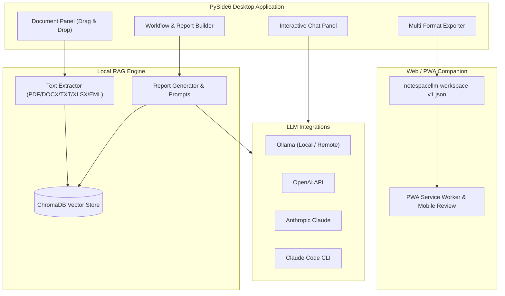

<!-- worldset: {"translated_from_sha256": "466a6a18b88506de47fa858aabc993da82eb017a6be4e93cbd9aea6ac61ec40f", "translator": "claude-haiku-5-5 with gpt-6-luna/max review and repairs", "translated_at": "2026-10-25T08:23:40.867192+00:00", "reviewer": "Root independent source/literal/encoding checks"} -->


# NoteSpaceLLM

[](LICENSE)
[](https://www.python.org/)
[]()
[](https://github.com/file-bricks)
[](https://github.com/open-bricks)
[](llms.txt)

[English](README.md) | [Deutsch](README_de.md) | [Español](README_es.md) | [简体中文](README_zh.md) | [日本語](README_ja.md) | [Русский](README_ru.md) | [Français](README_fr.md) | [हिन्दी](README_hi.md) | [العربية](README_ar.md) | [বাংলা](README_bn.md) | [Português](README_pt.md)

> **研究およびレポート生成のための、ローカル優先のドキュメントノートブックです。設定可能なローカルまたはリモートの言語モデルに対応しています。**

> [!NOTE]
> **AIエージェントおよび自動化ワークフロー向け:**
> NoteSpaceLLMは、機械可読なアーキテクチャと機能の概要を [`llms.txt`](llms.txt) で提供しています。

NoteSpaceLLMは、PDF、Word文書、Markdown、メールのエクスポート、メモ、研究フォルダを扱うためのローカル優先のPySide6デスクトップアプリです。デフォルトでプロジェクトデータをローカルに保持し、ローカルまたはリモートのOllama、OpenAI、Anthropic、Claude Codeのワークフローに対応し、分析結果をMarkdown、PDF、DOCX、HTML、TXTにエクスポートします。軽量なWeb/PWAコンパニオンも利用可能になり、文書をサーバーにアップロードすることなく、Android、iOS、ブラウザのデバイス上でエクスポートされたワークスペースを確認できます。

**検索キーワードの例:** NotebookLM の代替、ローカル RAG 文書分析、ローカル文書チャット、PySide6 の研究ツール、ローカルモデルを使ったレポート生成、ローカル優先の文書ワークフロー

## クイックスタート

```bash
git clone https://github.com/file-bricks/NoteSpaceLLM.git
cd NoteSpaceLLM
pip install -r requirements.txt
python main.py
```

Windowsでは、`start.bat` から起動することもできます。ローカルのWindowsランチャーは `build_exe.bat` でビルドできます。

依存関係をインストールし、スターター用のワークフロー/プロフィールフォルダを作成する、ガイド付きのローカルブートストラップを行うには、`python setup_environment.py` を明示的に実行してください。パッケージのメタデータとビルドは別の setuptools エントリポイントを使用し、これを実行しません。

テストとコンパイルのスモークチェックは次のコマンドで実行します:

```bash
pytest
python -m compileall -q main.py manage_translations.py setup_environment.py translator.py src
cd web_companion
npm test
```

## システムアーキテクチャ



## 機能

- **ドキュメント管理**: ドラッグ&ドロップでファイルやディレクトリを追加
- **自動抽出とインデックス作成**: 新しい文書は直ちに処理され、RAG用に準備されます。
- **選択的な分析**: 文書にチェックを入れる/外すことで、レポートに含めるか除外するかを指定
- **サブクエリ**: 文書を右クリックして、文書ごとの対象を絞った調査を実行
- **ワークフローの可視化**: レポートパイプラインのグラフィカルな概要
- **チャットインターフェース**: 任意のLLMを使い、読み込んだ文書に対して対話形式で質問
- **Claude Code連携**: 構造化されたAPIレスポンス、または対話型のClaude Codeセッションへの引き継ぎ
- **マルチフォーマットエクスポート**: MD、PDF、DOCX、HTML、TXTへの出力
- **プロンプトのエクスポート**: レポートのコンテキストを、外部のLLMワークフロー用にMarkdownプロンプトとして保存
- **Ollama接続プロフィール**: アプリ全体のプロバイダー設定を、複数のプロジェクトで再利用可能
- **言語サポート**: デスクトップGUIにはユーザーが選択できる言語はなく、インターフェースは現在主にドイツ語です。Web/PWAコンパニオンには、ドイツ語、英語、スペイン語、簡体字中国語、日本語、ロシア語、フランス語、ヒンディー語、アラビア語、ベンガル語、ポルトガル語を選択できる永続的なUI言語セレクターがあります。プロジェクトの言語フィールドはワークスペースのエクスポートに含まれますが、デスクトップUIやレポート言語の選択には接続されていません。
- **ウムラウト対応のUI**: ドイツ語のUI文字列では本来のウムラウトを使用し、翻訳スキャナーは英語の誤検出を回避します
- **プロフィール**: 再利用可能な出力フォーマットの組み合わせ

## インストール

```bash
# Clone or copy the project folder
cd NoteSpaceLLM

# Install dependencies
pip install -r requirements.txt

# Start the app
python main.py
```

依存関係を確認します:

```bash
python main.py --check
```

## LLM の設定

### Ollama（ローカル — 推奨）

1. [Ollama をインストール](https://ollama.ai)
2. モデルをダウンロード: `ollama pull llama3`
3. アプリで: メニュー > LLM > Use Ollama

### Ollama（リモートサーバー）

NoteSpaceLLM は、たとえば [ellmos-stack](https://github.com/ellmos-ai/ellmos-stack) を介して、リモートの Ollama サーバーに接続できます:

1. アプリで: メニュー > LLM > Settings
2. **Ollama URL:** `http://your-server:11435`（またはお使いのポート）
3. **API Key:** サーバーが認証プロキシの背後にある場合（推奨）

> **ヒント:** Ollama には組み込みの認証機能がありません。リモートアクセスには、API キーまたは Basic 認証を備えたリバースプロキシ（例: Nginx）を使用してください。

Ollama のエンドポイントとモデルは、プロジェクトごとではなく、アプリ全体の設定または選択された接続プロフィールで構成されます。アプリで保存された API キーは、オペレーティングシステムの資格情報ストアを通じて保存されます。任意の `NOTESPACELLM_OLLAMA_API_KEY` 環境変数は、保存されたキーより優先され、アプリによって書き込まれることはありません。レガシーの平文キーは、設定で明示的に移行するまで送信されません。

構成されたOllamaサーバーがリモートの場合、埋め込み用のドキュメント本文と、生成用に送信されるプロンプトやコンテキストを受信します。APIキーは、Bearerヘッダーとして設定されたURLに送信されます。プレーンHTTPではコンテンツも認証情報も暗号化されず、HTTPSの動作はエンドポイントとその証明書によって異なります。

### OpenAI

```bash
export OPENAI_API_KEY="<your-openai-api-key>"
```

### Anthropic (Claude)

```bash
export ANTHROPIC_API_KEY="<your-anthropic-api-key>"
```

### Claude Code

ローカルのCLIが必要です:

```bash
npm install -g @anthropic-ai/claude-code
```

アプリでは2つのモードが利用できます:
- **APIモード**: 構造化された応答がNoteSpaceLLMに直接返されます
- **チャットモード**: プロンプトを対話型のClaude Codeコンソールに引き渡します

## 使い方

### 1. ドキュメントの追加

- **ドラッグ&ドロップ**: 左パネルにファイルまたはフォルダーをドロップします
- **ボタン**: 「Add files」または「Add folder」

### 2. ドキュメントの選択

- チェックボックス: 分析対象のドキュメントを含める/除外する
- ボタン: 一括選択のための「All」/「None」

### 3. サブクエリ（任意）

ドキュメントを右クリックします:
- **Create summary**: 自動要約
- **Extract information**: 特定のデータを検索
- **Analyse**: 対象を絞った分析
- **Ask question**: ドキュメントに関する特定の質問

### 4. 主要な質問の定義

ワークフローパネルに中心となる研究上の質問を入力します。

### 5. ワークフロー/レポートタイプの選択

- **Analysis**: 提言を含む包括的な分析
- **Summary**: 短い要約
- **Research report**: 学術的な構成
- **Comparison**: 体系的なドキュメント比較

### 6. レポートの生成

「Create report」をクリックすると、出力が右パネルに表示されます。

### 7. エクスポート

出力形式を選択し、「Export」をクリックします。

### 8. プロンプトのエクスポート

**「Export prompt」**を使用すると、現在の作業コンテキストをMarkdownファイルとして保存でき、Claude Codeやその他のLLMワークフローで利用できます。

## Web/PWAコンパニオン

`web_companion/` の下には、Android、iOS、ブラウザー向けの読み取り専用のCompanionストランドがあります。エクスポートされた`notespacellm-workspace-v1.json`ファイルをブラウザー内でローカルにインポートし、レポート、ドキュメントのメタデータ、選択された抜粋を表示し、レビューメモをMarkdownとしてエクスポートできます。ワークスペースは現在のブラウザーセッション内に保持され、再度開いた後は再インポートが必要です。ローカルに保存されるのはレビューメモとUIのロケールのみです。

ローカルブラウザーテスト:

```powershell
$env:PYTHONIOENCODING='utf-8'
python -m http.server 8765 -d web_companion
```

Companionのスモークテスト:

```powershell
cd web_companion
node --test tests/library.test.mjs
```

Android/iOS PWAのテスト計画は`web_companion/PWA_TESTPLAN.md`に記載されています。

## プラットフォーム戦略

デスクトップアプリは、ローカルのドキュメント、RAGインデックス、プロバイダー接続のためのフルアプリケーションです。Android、iOS、ブラウザーのWeb/PWAコンパニオンは、ユーザーが作成した`notespacellm-workspace-v1.json`エクスポートを確認するために利用できます。機密性の高い資料については、ローカルのモデルおよび埋め込みエンドポイントを設定し、共有前にエクスポートを確認してください。データのやり取りの仕様は`EXPORTFORMAT.md`に記載されています。

### macOSおよびLinuxのソーススモークテスト

GitHub Actionsで追加のソーススモークテストが実行されます:
- `tests/platform_smoke.py` — オフスクリーンのPySide6起動、ドキュメントのインポート、レポートのエクスポート、ワークスペースJSONのエクスポート
- `tests/linux_platform_smoke.py` — `ubuntu-latest`向けのLinux固有のラッパー

## プロジェクト構造

```
NoteSpaceLLM/
├── main.py                 # Entry point
├── requirements.txt        # Dependencies
├── translator.py           # Translation-catalog scan/helper; no desktop language switch
├── locales/                # Catalog inputs for the translation helper
├── src/
│   ├── core/              # Core functionality
│   │   ├── document_manager.py
│   │   ├── text_extractor.py
│   │   ├── sub_query.py
│   │   └── project.py
│   ├── gui/               # PySide6 UI
│   │   ├── main_window.py
│   │   ├── document_panel.py
│   │   ├── workflow_panel.py
│   │   ├── chat_panel.py
│   │   └── output_panel.py
│   ├── llm/               # LLM integration (local + remote)
│   │   ├── client.py
│   │   ├── ollama_client.py
│   │   ├── openai_client.py
│   │   └── anthropic_client.py
│   └── reports/           # Report generation
│       ├── generator.py
│       ├── templates.py
│       └── exporter.py
├── web_companion/         # PWA Companion
├── data/                  # Project data (gitignored)
├── workflows/             # Workflow definitions
├── profiles/              # Output profiles
└── output/                # Exported reports
```

## 対応ファイル形式

| 形式   | 読み取り | 書き出し |
|--------|----------|----------|
| PDF    | ✅       | ✅       |
| DOCX   | ✅       | ✅       |
| DOC    | ⚠️       | —        |
| TXT    | ✅       | ✅       |
| MD     | ✅       | ✅       |
| XLSX   | ✅       | —        |
| HTML   | —        | ✅       |
| EML    | ✅       | —        |
| MSG    | ✅       | —        |

⚠️ .docにはantiwordまたはLibreOfficeが必要です

## プライバシー

NoteSpaceLLMは、プロジェクトデータ、ドキュメントのインデックス、プロファイル、ワークフロー設定、エクスポートを、`data/`、`profiles/`、`workflows/`、`output/`、`chroma_db/`にローカルで保存します。これらのフォルダーはGitの管理対象から意図的に除外されています。

外部のLLMプロバイダー（OpenAI、Anthropic、Claude Code、リモートのOllama）が有効な場合、プロンプトと選択されたドキュメントの抜粋がそれらのサービスに送信される可能性があります。リモートのOllamaエンドポイントは、埋め込みに使用されるドキュメント本文も受信します。機密性の高いドキュメントについては、ローカルのモデルおよび埋め込みエンドポイントを使用し、共有前にエクスポートされたレポート、チャット履歴、選択された抜粋を確認してください。ワークスペースのエクスポートは匿名化されていません。

## ヒント

1. **大量のドキュメントセット**: より速い結果を得るために、まず関連するドキュメントのみを選択してください
2. **サブクエリ**: より高品質な分析のために、対象を絞ったサブクエリを使用してください
3. **Ollama**: ローカルのOllamaエンドポイントはオフライン処理に対応しています。
4. **ワークフローの順序**: ワークフローパネルでステップの順序を変更できます

## ライセンス

AGPL-3.0-only — [LICENSE](LICENSE) を参照

本プロジェクトはPySide6およびPyMuPDFを宣言しています。選択された上流のライセンス参照については[THIRD_PARTY_LICENSES.md](THIRD_PARTY_LICENSES.md)を参照してください。本プロジェクト自体のライセンスはAGPL-3.0-onlyです。

## 関連プロジェクト

[KnowledgeDigest](https://github.com/file-bricks/KnowledgeDigest)は、SQLite/FTS5検索と任意のLLM要約機能を備えた、別個のローカル知識データベースです。NoteSpaceLLMとは統合されていません。

## ライセンスおよび保守に関する通知

プロジェクトのライセンス条件については[LICENSE](LICENSE)を参照してください。メンテナーは、継続的な保守や提供を約束するものではありません。
