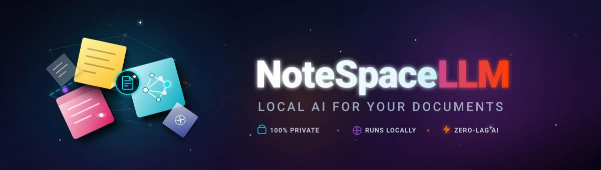

[English](README.md) · [Deutsch](README_de.md) · [Español](README_es.md) · [简体中文](README_zh.md) · [日本語](README_ja.md) · [Русский](README_ru.md)

# NoteSpaceLLM Pro

[](LICENSE)
[](https://www.python.org/)
[]()
[]()

> **プライベートな文書分析、RAG支援研究、マルチフォーマットレポート作成のためのローカル優先NotebookLMオルタナティブ。**

NoteSpaceLLM Pro は、高度なドキュメント分析、知的ノート管理、AIアシスト研究のための完全プライベートなローカルワークステーションです。クラウド型サービスに代わるプライバシー保護重視の設計により、すべての文書やベクトルインデックスをご自身のデバイス上で安全に保持します。

PDF、Word文書、Markdown、メールエクスポート、テキストメモ、研究フォルダの読み込みに対応。ローカルLLM（Ollama経由など）を用いた完全オフライン動作から、安全なAPI連携（Anthropic Claude、OpenAI）まで柔軟にサポートします。分析結果はMarkdown、PDF、DOCX、HTML、TXT形式で出力可能。付属の軽量Web/PWAコンパニオンにより、外部サーバーを介さずにAndroid、iOS、ブラウザ上でエクスポート済みワークスペースをオフライン確認できます。

## クイックスタート

```bash
git clone https://github.com/file-bricks/NoteSpaceLLM.git
cd NoteSpaceLLM
pip install -r requirements.txt
python main.py
```

Windows環境では `start.bat` からも起動できます。スタンドアロンの実行ファイル（EXE）は `build_exe.bat` でビルド可能です。

テストとコンパイル検証の実行:

```bash
python -m pytest -q
python manage_translations.py --check
python scripts/check_store_readiness.py
python -m compileall -q main.py manage_translations.py translator.py src
```

## 主な機能

- **ドキュメント管理**: ドラッグ＆ドロップによるファイルおよびフォルダの一括インポート
- **自動インデックス作成**: 新規文書を即座にセグメント化しRAG検索インデックスへ登録
- **個別選択**: 特定の文書のみをレポート対象として自在にオン/オフ切り替え
- **サブクエリ**: 文書を右クリックして個別の特定論点にフォーカスした質問が可能
- **ワークフロー可視化**: 分析・レポートパイプライン全体の進行状況をグラフィカルに表示
- **インタラクティブチャット**: 読み込んだドキュメントを対象とした文脈把握型チャット
- **ディープリサーチ（Deep Research）**: 構造化された総合調査レポートおよび自動要約の生成
- **多彩なエクスポート**: Markdown、PDF、DOCX、HTML、テキスト形式に対応
- **プロンプト出力**: レポート文脈をMarkdownプロンプトとして外部モデル用に保存
- **Tier-2 6言語対応**: インターフェースおよびメタデータをDE、EN、ES、ZH、JA、RUで提供
- **完全ローカル＆プライバシー保護**: ローカルベクトルDB（ChromaDB）採用、外部への強制アップロードなし

## ライセンスとプライバシー

NoteSpaceLLM は **AGPL-3.0** ライセンスのもとで公開されています。すべての解析データおよびベクトルインデックスはお手元のローカルストレージにのみ保存されます。
