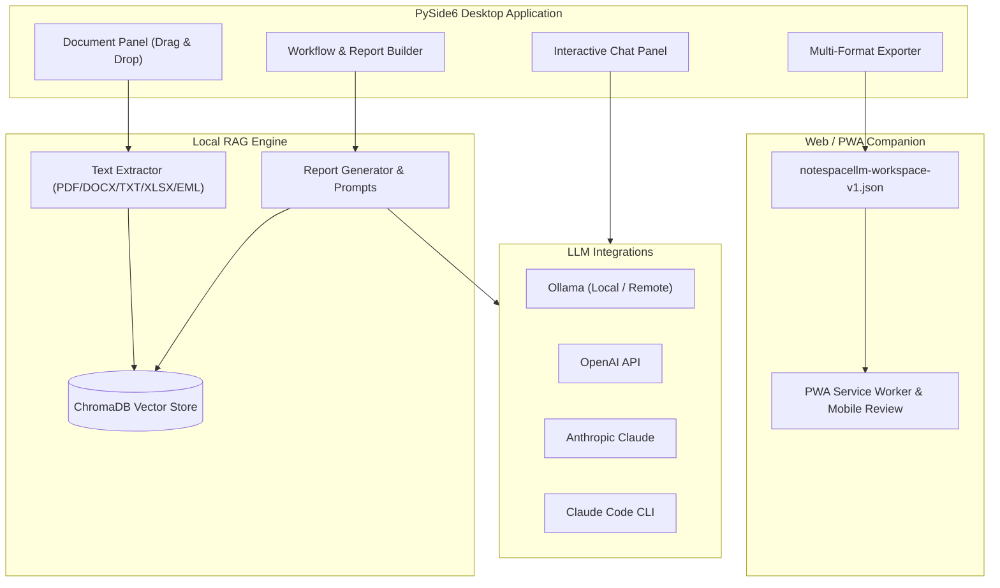

<!-- worldset: {"translated_from_sha256": "466a6a18b88506de47fa858aabc993da82eb017a6be4e93cbd9aea6ac61ec40f", "translator": "claude-haiku-5-5 with gpt-6-luna/max review and repairs", "translated_at": "2026-10-25T08:23:41.463896+00:00", "reviewer": "Root independent source/literal/encoding checks"} -->


# NoteSpaceLLM

[](LICENSE)
[](https://www.python.org/)
[]()
[](https://github.com/file-bricks)
[](https://github.com/open-bricks)
[](llms.txt)

[English](README.md) | [Deutsch](README_de.md) | [Español](README_es.md) | [简体中文](README_zh.md) | [日本語](README_ja.md) | [Русский](README_ru.md) | [Français](README_fr.md) | [हिन्दी](README_hi.md) | [العربية](README_ar.md) | [বাংলা](README_bn.md) | [Português](README_pt.md)

> **Caderno de documentos local-first para pesquisa e geração de relatórios com modelos de linguagem locais ou remotos configuráveis.**

> [!NOTE]
> **Para Agentes de IA e Fluxos de Trabalho Automatizados:**
> O NoteSpaceLLM fornece uma visão geral da arquitetura e dos recursos legível por máquina em [`llms.txt`](llms.txt).

O NoteSpaceLLM é um aplicativo de desktop local-first em PySide6 para trabalhar com PDFs,
arquivos Word, Markdown, exportações de e-mail, notas e pastas de pesquisa. Ele mantém
os dados do projeto localmente por padrão, oferece suporte a fluxos de trabalho com Ollama local ou remoto, OpenAI,
Anthropic e Claude Code, e exporta os resultados de análise para Markdown,
PDF, DOCX, HTML e TXT. Um Companion Web/PWA leve já está disponível para
revisar workspaces exportados em dispositivos Android, iOS e navegadores, sem
enviar documentos a um servidor.

**Buscas mais relevantes:** alternativa ao NotebookLM, análise de documentos com RAG local,
chat com documentos locais, ferramenta de pesquisa em PySide6, gerador de relatórios com modelos locais,
fluxo de trabalho de documentos local-first.

## Início Rápido

```bash
git clone https://github.com/file-bricks/NoteSpaceLLM.git
cd NoteSpaceLLM
pip install -r requirements.txt
python main.py
```

No Windows, você também pode iniciar via `start.bat`. Um iniciador local para Windows pode ser criado com `build_exe.bat`.

Para uma inicialização local guiada, que instala os requisitos e cria as pastas iniciais de fluxos de trabalho/perfis, execute explicitamente `python setup_environment.py`. Os metadados do pacote e as compilações usam o ponto de entrada separado do setuptools e não o executam.

Execute os testes e as verificações de compilação rápidas com:

```bash
pytest
python -m compileall -q main.py manage_translations.py setup_environment.py translator.py src
cd web_companion
npm test
```

## Arquitetura do Sistema



## Recursos

- **Gerenciamento de documentos**: Adicione arquivos e diretórios por arrastar e soltar
- **Extração e indexação automáticas**: Novos documentos são processados imediatamente e preparados para RAG.
- **Análise seletiva**: Marque/desmarque documentos para incluí-los ou excluí-los dos relatórios
- **Subconsultas**: Clique com o botão direito em um documento para pesquisas direcionadas a esse documento
- **Visualização do fluxo de trabalho**: Visão gráfica do pipeline de relatórios
- **Interface de chat**: Chat interativo sobre os documentos carregados com qualquer LLM
- **Integração com Claude Code**: Respostas estruturadas da API ou transferência para uma sessão interativa do Claude Code
- **Exportação em múltiplos formatos**: Saída para MD, PDF, DOCX, HTML, TXT
- **Exportação de prompt**: Salve o contexto do relatório como um prompt em Markdown para fluxos de trabalho com LLMs externos
- **Perfis de conexão com Ollama**: As configurações de provedor válidas para todo o aplicativo podem ser reutilizadas entre projetos
- **Suporte a idiomas**: A GUI de desktop não tem seletor de idioma para o usuário; sua interface é atualmente, em grande parte, em alemão. O Companion Web/PWA tem um seletor persistente de idioma da interface para alemão, inglês, espanhol, chinês simplificado, japonês, russo, francês, hindi, árabe, bengali e português. O campo de idioma do projeto é incluído nas exportações de workspace; ele não está conectado a um seletor de idioma da interface de desktop nem do relatório.
- **Interface segura para umlauts**: Textos da interface em alemão usam umlauts nativos; o verificador de tradução evita falsos positivos em inglês
- **Perfis**: Combinações reutilizáveis de formatos de saída

## Instalação

```bash
# Clone or copy the project folder
cd NoteSpaceLLM

# Install dependencies
pip install -r requirements.txt

# Start the app
python main.py
```

Verifique as dependências:

```bash
python main.py --check
```

## Configuração de LLM

### Ollama (Local — Recomendado)

1. [Instale o Ollama](https://ollama.ai)
2. Baixe um modelo: `ollama pull llama3`
3. No aplicativo: Menu > LLM > Usar Ollama

### Ollama (Servidor Remoto)

O NoteSpaceLLM pode se conectar a um servidor Ollama remoto, por exemplo via [ellmos-stack](https://github.com/ellmos-ai/ellmos-stack):

1. No aplicativo: Menu > LLM > Configurações
2. **URL do Ollama:** `http://your-server:11435` (ou a sua porta)
3. **Chave de API:** Se o servidor estiver atrás de um proxy de autenticação (recomendado)

> **Dica:** O Ollama não possui autenticação integrada. Para acesso remoto, use um proxy reverso (por exemplo, Nginx) com chave de API ou Basic Auth.

O endpoint e o modelo do Ollama são configurados nas configurações válidas para todo o aplicativo ou no
perfil de conexão selecionado, não por projeto. As chaves de API são armazenadas pelo
cofre de credenciais do sistema operacional quando salvas no aplicativo. A variável de ambiente
`NOTESPACELLM_OLLAMA_API_KEY` opcional substitui a chave salva e
nunca é gravada pelo aplicativo. Chaves em texto simples legadas não são enviadas até que você
migre-as explicitamente nas configurações.

Quando o servidor Ollama configurado é remoto, ele recebe o texto dos documentos usado para embeddings e os prompts/contexto enviados para geração. A chave de API é enviada para a URL configurada como cabeçalho Bearer. HTTP simples não criptografa nem o conteúdo nem as credenciais; o comportamento do HTTPS depende do endpoint e do seu certificado.

### OpenAI

```bash
export OPENAI_API_KEY="<your-openai-api-key>"
```

### Anthropic (Claude)

```bash
export ANTHROPIC_API_KEY="<your-anthropic-api-key>"
```

### Claude Code

Requer a CLI local:

```bash
npm install -g @anthropic-ai/claude-code
```

Há dois modos disponíveis no aplicativo:
- **Modo API**: a resposta estruturada é retornada diretamente ao NoteSpaceLLM
- **Modo chat**: entrega o prompt a um console interativo do Claude Code

## Uso

### 1. Adicionar documentos

- **Arrastar e soltar**: solte arquivos ou pastas no painel esquerdo
- **Botão**: "Add files" ou "Add folder"

### 2. Selecionar documentos

- Caixa de seleção: inclui/exclui documentos da análise
- Botões: "All" / "None" para seleção em massa

### 3. Subconsultas (opcional)

Clique com o botão direito em um documento:
- **Create summary**: resumo automático
- **Extract information**: localizar dados específicos
- **Analyse**: análise direcionada
- **Ask question**: pergunta específica sobre o documento

### 4. Definir a pergunta principal

Insira a pergunta central da pesquisa no painel de fluxo de trabalho.

### 5. Escolher o tipo de fluxo de trabalho/relatório

- **Analysis**: análise abrangente com recomendações
- **Summary**: resumo curto
- **Research report**: estrutura acadêmica
- **Comparison**: comparação sistemática de documentos

### 6. Gerar relatório

Clique em "Create report" — a saída aparece no painel direito.

### 7. Exportar

Selecione os formatos de saída e clique em "Export".

### 8. Exportação de prompt

Use **"Export prompt"** para salvar o contexto de trabalho atual como arquivo Markdown para uso no Claude Code ou em outros fluxos de trabalho com LLM.

## Companion Web/PWA

Sob `web_companion/` há um Companion somente leitura para Android, iOS e navegador. Ele importa localmente, no navegador, arquivos `notespacellm-workspace-v1.json` exportados, exibe o relatório, os metadados dos documentos e os trechos selecionados, e pode exportar notas de revisão em Markdown. O workspace permanece na sessão atual do navegador e deve ser importado novamente após reabrir; somente as notas de revisão e o idioma da interface são persistidos localmente.

Teste local no navegador:

```powershell
$env:PYTHONIOENCODING='utf-8'
python -m http.server 8765 -d web_companion
```

Smokes do Companion:

```powershell
cd web_companion
node --test tests/library.test.mjs
```

O plano de testes do PWA para Android/iOS está documentado em `web_companion/PWA_TESTPLAN.md`.

## Estratégia de plataforma

O aplicativo desktop é a aplicação completa para documentos locais, o índice RAG e as conexões com provedores. O Companion Web/PWA para Android, iOS e navegador está disponível para revisar uma exportação `notespacellm-workspace-v1.json` criada pelo usuário.
Para material sensível, configure endpoints locais de modelo e de embeddings e revise as exportações antes de compartilhar. O contrato de troca está documentado em `EXPORTFORMAT.md`.

### Smokes de código-fonte para macOS e Linux

Smokes adicionais de código-fonte são executados no GitHub Actions:
- `tests/platform_smoke.py` — início offscreen do PySide6, importação de documentos, exportação de relatório e exportação de workspace em JSON
- `tests/linux_platform_smoke.py` — wrapper específico para Linux sobre `ubuntu-latest`

## Estrutura do projeto

```
NoteSpaceLLM/
├── main.py                 # Entry point
├── requirements.txt        # Dependencies
├── translator.py           # Translation-catalog scan/helper; no desktop language switch
├── locales/                # Catalog inputs for the translation helper
├── src/
│   ├── core/              # Core functionality
│   │   ├── document_manager.py
│   │   ├── text_extractor.py
│   │   ├── sub_query.py
│   │   └── project.py
│   ├── gui/               # PySide6 UI
│   │   ├── main_window.py
│   │   ├── document_panel.py
│   │   ├── workflow_panel.py
│   │   ├── chat_panel.py
│   │   └── output_panel.py
│   ├── llm/               # LLM integration (local + remote)
│   │   ├── client.py
│   │   ├── ollama_client.py
│   │   ├── openai_client.py
│   │   └── anthropic_client.py
│   └── reports/           # Report generation
│       ├── generator.py
│       ├── templates.py
│       └── exporter.py
├── web_companion/         # PWA Companion
├── data/                  # Project data (gitignored)
├── workflows/             # Workflow definitions
├── profiles/              # Output profiles
└── output/                # Exported reports
```

## Formatos de arquivo suportados

| Formato | Leitura | Escrita |
|---------|---------|---------|
| PDF     | ✅      | ✅      |
| DOCX    | ✅      | ✅      |
| DOC     | ⚠️      | —       |
| TXT     | ✅      | ✅      |
| MD      | ✅      | ✅      |
| XLSX    | ✅      | —       |
| HTML    | —       | ✅      |
| EML     | ✅      | —       |
| MSG     | ✅      | —       |

⚠️ .doc requer antiword ou LibreOffice

## Privacidade

O NoteSpaceLLM armazena localmente dados de projetos, índices de documentos, perfis, configurações de fluxo de trabalho e exportações em `data/`, `profiles/`, `workflows/`, `output/` e
`chroma_db/`. Essas pastas são intencionalmente excluídas do Git.

Quando provedores externos de LLM (OpenAI, Anthropic, Claude Code, Ollama remoto) estão habilitados, prompts e trechos de documentos selecionados podem ser transmitidos a esses serviços. Um endpoint Ollama remoto também recebe o texto dos documentos usado para embeddings. Para documentos sensíveis, use endpoints locais de modelo e de embeddings e revise os relatórios exportados, o histórico de chat e os trechos selecionados antes de compartilhar; as exportações de workspace não são anonimizadas.

## Dicas

1. **Conjuntos grandes de documentos**: selecione primeiro apenas os documentos relevantes para resultados mais rápidos
2. **Subconsultas**: use subconsultas direcionadas para análises de maior qualidade
3. **Ollama**: um endpoint Ollama local permite processamento offline.
4. **Ordem do fluxo de trabalho**: as etapas podem ser reordenadas no painel de fluxo de trabalho

## Licença

AGPL-3.0-only — veja [LICENSE](LICENSE)

Este projeto declara PySide6 e PyMuPDF. Veja as referências de licença upstream selecionadas em [THIRD_PARTY_LICENSES.md](THIRD_PARTY_LICENSES.md); a licença do próprio projeto é AGPL-3.0-only.

## Projeto relacionado

[KnowledgeDigest](https://github.com/file-bricks/KnowledgeDigest) é um banco de dados de conhecimento local separado, com busca SQLite/FTS5 e resumos opcionais por LLM; ele não é integrado ao NoteSpaceLLM.

## Aviso de licença e manutenção

Veja [LICENSE](LICENSE) para os termos de licença do projeto. Os mantenedores não prometem manutenção contínua nem disponibilidade.
