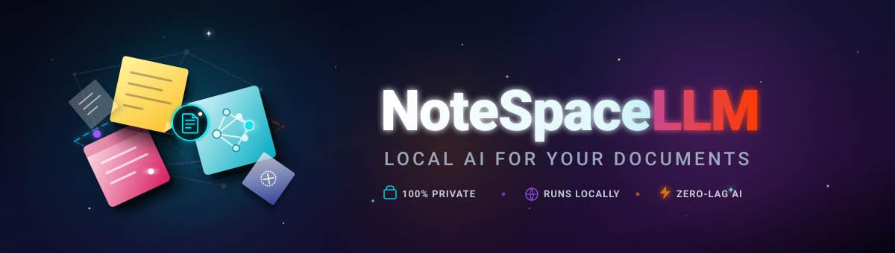

[English](README.md) · [Deutsch](README_de.md) · [Español](README_es.md) · [简体中文](README_zh.md) · [日本語](README_ja.md) · [Русский](README_ru.md)

# NoteSpaceLLM Pro

[](LICENSE)
[](https://www.python.org/)
[]()
[]()

> **Локальная альтернатива NotebookLM для приватного анализа документов, RAG-исследований и формирования отчетов в различных форматах.**

NoteSpaceLLM Pro — это ваше персональное локальное рабочее пространство для глубокого анализа документов, ведения интеллектуальных заметок и исследований с поддержкой искусственного интеллекта. Разработанный как приватная альтернатива облачным сервисам, NoteSpaceLLM сохраняет все ваши файлы, заметки и векторные индексы исключительно на локальном устройстве.

Приложение поддерживает чтение PDF, документов Word, заметок Markdown, архивов почты и исследовательских каталогов. Оно работает автономно с локальными моделями (например, через Ollama) или подключается к защищенным API (Anthropic Claude, OpenAI). Результаты можно экспортировать в форматы Markdown, PDF, DOCX, HTML и TXT. Входящий в комплект легкий автономный Web/PWA-компаньон позволяет изучать экспортированные базы знаний на смартфонах и планшетах без внешних серверов.

## Быстрый старт

```bash
git clone https://github.com/file-bricks/NoteSpaceLLM.git
cd NoteSpaceLLM
pip install -r requirements.txt
python main.py
```

В Windows приложение также можно запустить через `start.bat`. Автономный исполняемый файл (EXE) собирается при помощи `build_exe.bat`.

Запуск тестов и проверка синтаксиса:

```bash
python -m pytest -q
python manage_translations.py --check
python scripts/check_store_readiness.py
python -m compileall -q main.py manage_translations.py translator.py src
```

## Основные возможности

- **Управление документами**: импорт файлов и каталогов простым перетаскиванием (Drag & Drop)
- **Автоматическая индексация**: немедленная подготовка векторного RAG-индекса для новых документов
- **Выборочный анализ**: включение или исключение отдельных документов из формирования отчетов
- **Подзапросы к документам**: точечные вопросы к конкретному файлу через контекстное меню
- **Визуализация конвейера**: графическая схема всех этапов обработки документации
- **Интерактивный диалог**: контекстный чат по загруженным материалам с любой языковой моделью
- **Глубокие исследования (Deep Research)**: автоматизированное создание структурированных аналитических отчетов
- **Универсальный экспорт**: сохранение в форматы Markdown, PDF, DOCX, HTML и простой текст
- **Экспорт промптов**: сохранение контекста отчета в виде промпта Markdown для внешних ИИ-систем
- **Поддержка 6 языков (Tier-2)**: интерфейс и метаданные на DE, EN, ES, ZH, JA и RU
- **Конфиденциальность и Zero-Egress**: локальная база данных векторов (ChromaDB), без принудительной выгрузки в сеть

## Лицензия и безопасность данных

NoteSpaceLLM распространяется по лицензии **AGPL-3.0**. Все исходные материалы, аналитические выкладки и векторные индексы хранятся строго локально на вашем компьютере.
