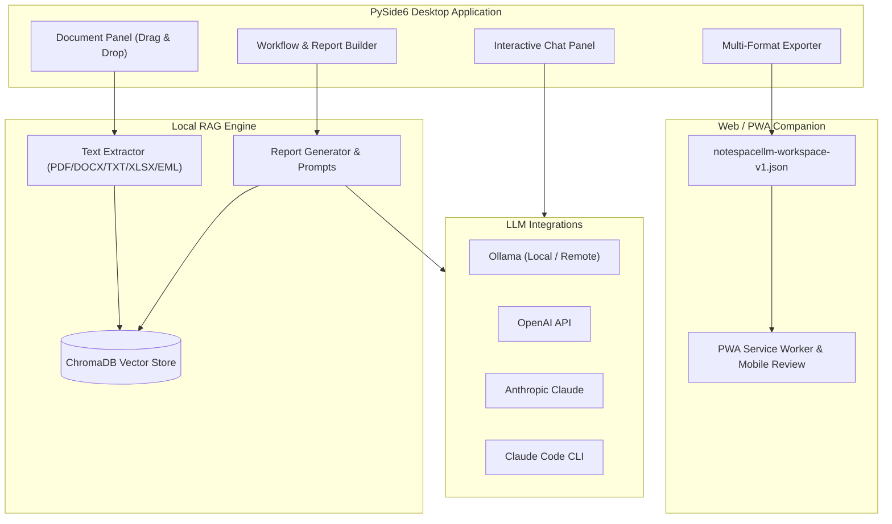

<!-- worldset: {"translated_from_sha256": "5156cab29500f95cbddd18a51dac493ccd36033b452d6cee3bd12f1ad5893194", "translator": "claude-haiku-5-5 with gpt-6-luna/max review and repairs", "translated_at": "2026-10-25T08:23:43.246386+00:00", "reviewer": "Root independent source/literal/encoding checks"} -->


# NoteSpaceLLM

[](LICENSE)
[](https://www.python.org/)
[]()
[](https://github.com/file-bricks)
[](https://github.com/open-bricks)
[](llms.txt)

[English](README.md) | [Deutsch](README_de.md) | [Español](README_es.md) | [简体中文](README_zh.md) | [日本語](README_ja.md) | [Русский](README_ru.md) | [Français](README_fr.md) | [हिन्दी](README_hi.md) | [العربية](README_ar.md) | [বাংলা](README_bn.md) | [Português](README_pt.md)

> **Локальный блокнот для документов с приоритетом локальной работы, предназначенный для исследований и генерации отчётов с настраиваемыми локальными или удалёнными языковыми моделями.**

> [!NOTE]
> **Для ИИ-агентов и автоматизированных рабочих процессов:**
> NoteSpaceLLM предоставляет машиночитаемый обзор архитектуры и функций в [`llms.txt`](llms.txt).

NoteSpaceLLM — это настольное приложение на PySide6 с приоритетом локальной работы для работы с PDF,
файлами Word, Markdown, экспортами почты, заметками и папками с исследовательскими материалами. По умолчанию оно
хранит данные проектов локально, поддерживает локальные или удалённые сценарии работы с Ollama, OpenAI,
Anthropic и Claude Code и экспортирует результаты анализа в Markdown,
PDF, DOCX, HTML и TXT. Облегчённый Web/PWA-компаньон теперь доступен для
просмотра экспортированных рабочих пространств на Android, iOS и в браузерах без
загрузки документов на сервер.

**Наиболее подходящие поисковые запросы:** альтернатива NotebookLM, локальный анализ документов по схеме RAG,
локальный чат с документами, исследовательский инструмент на PySide6, генератор отчётов на локальных моделях,
рабочий процесс с документами с приоритетом локальной работы.

## Быстрый старт

```bash
git clone https://github.com/file-bricks/NoteSpaceLLM.git
cd NoteSpaceLLM
pip install -r requirements.txt
python main.py
```

В Windows можно также запустить через `start.bat`. Локальный загрузчик для Windows можно собрать с помощью `build_exe.bat`.

Для направляемой локальной начальной настройки, которая устанавливает требования и создаёт стартовые
папки рабочих процессов и профилей, явно выполните `python setup_environment.py`. Метаданные пакета и сборки используют
отдельную точку входа setuptools и её не запускают.

Запуск тестов и проверок компиляции (smoke-тестов):

```bash
pytest
python -m compileall -q main.py manage_translations.py setup_environment.py translator.py src
cd web_companion
npm test
```

## Архитектура системы



## Возможности

- **Управление документами**: добавление файлов и каталогов перетаскиванием (drag & drop)
- **Автоматическое извлечение и индексирование**: новые документы обрабатываются сразу и подготавливаются для RAG.
- **Выборочный анализ**: отметьте или снимите отметку с документов, чтобы включить их в отчёты или исключить из них
- **Подзапросы**: щёлкните документ правой кнопкой мыши для целевого исследования конкретного документа
- **Визуализация рабочего процесса**: графический обзор конвейера формирования отчёта
- **Интерфейс чата**: интерактивный чат по загруженным документам с любой LLM
- **Интеграция с Claude Code**: структурированные ответы API или передача интерактивному сеансу Claude Code
- **Экспорт в несколько форматов**: вывод в MD, PDF, DOCX, HTML, TXT
- **Экспорт промптов**: сохранение контекста отчёта как Markdown-промпта для внешних рабочих процессов с LLM
- **Профили подключения к Ollama**: настройки провайдера для всего приложения можно повторно использовать в разных проектах
- **Поддержка языков**: В настольном интерфейсе и Web/PWA Companion есть сохраняемый выбор из одиннадцати языков: английского, немецкого, испанского, упрощённого китайского, японского, русского, французского, хинди, арабского, бенгальского и португальского. Для арабского используется раскладка справа налево. Поле языка проекта включается в экспорт рабочего пространства как метаданные; оно не меняет язык интерфейса и не определяет язык создаваемых отчётов.
- **Интерфейс, безопасный для умлаутов**: немецкие строки интерфейса используют собственные умлауты; сканер переводов исключает ложные срабатывания английского языка
- **Профили**: повторно используемые комбинации форматов вывода

## Установка

```bash
# Clone or copy the project folder
cd NoteSpaceLLM

# Install dependencies
pip install -r requirements.txt

# Start the app
python main.py
```

Проверьте зависимости:

```bash
python main.py --check
```

## Настройка LLM

### Ollama (локально — рекомендуется)

1. [Установите Ollama](https://ollama.ai)
2. Загрузите модель: `ollama pull llama3`
3. В приложении: Меню > LLM > Использовать Ollama

### Ollama (удалённый сервер)

NoteSpaceLLM может подключаться к удалённому серверу Ollama, например через [ellmos-stack](https://github.com/ellmos-ai/ellmos-stack):

1. В приложении: Меню > LLM > Настройки
2. **URL Ollama:** `http://your-server:11435` (или ваш порт)
3. **Ключ API:** если сервер находится за прокси-сервером аутентификации (рекомендуется)

> **Совет:** Ollama не имеет встроенной аутентификации. Для удалённого доступа используйте обратный прокси (например, Nginx) с ключом API или Basic Auth.

Конечная точка Ollama и модель настраиваются в общих настройках приложения или
выбранном профиле подключения, а не для каждого проекта. Ключи API сохраняются через
хранилище учётных данных операционной системы, если они сохранены в приложении. Необязательная
переменная окружения `NOTESPACELLM_OLLAMA_API_KEY` переопределяет сохранённый ключ и
никогда не записывается приложением. Устаревшие ключи в открытом виде не отправляются, пока вы
явно не выполните их миграцию в настройках.

Когда настроенный сервер Ollama является удалённым, он получает текст документов, используемый для эмбеддингов, а также промпты и контекст, отправляемые для генерации. API-ключ передаётся на настроенный URL в заголовке Bearer. Обычный HTTP не шифрует ни содержимое, ни учётные данные; поведение HTTPS зависит от конечной точки и её сертификата.

### OpenAI

```bash
export OPENAI_API_KEY="<your-openai-api-key>"
```

### Anthropic (Claude)

```bash
export ANTHROPIC_API_KEY="<your-anthropic-api-key>"
```

### Claude Code

Требуется локальный CLI:

```bash
npm install -g @anthropic-ai/claude-code
```

В приложении доступны два режима:
- **Режим API**: структурированный ответ возвращается напрямую в NoteSpaceLLM
- **Режим чата**: промпт передаётся в интерактивную консоль Claude Code

## Использование

### 1. Добавление документов

- **Перетаскивание**: перетащите файлы или папки на левую панель
- **Кнопка**: «Add files» или «Add folder»

### 2. Выбор документов

- Флажок: включить/исключить документ из анализа
- Кнопки: «All» / «None» для массового выбора

### 3. Подзапросы (необязательно)

Щёлкните документ правой кнопкой мыши:
- **Create summary**: автоматическое резюме
- **Extract information**: поиск конкретных данных
- **Analyse**: целевой анализ
- **Ask question**: конкретный вопрос о документе

### 4. Определение основного вопроса

Введите центральный исследовательский вопрос на панели рабочего процесса.

### 5. Выбор типа рабочего процесса/отчёта

- **Analysis**: всесторонний анализ с рекомендациями
- **Summary**: краткое резюме
- **Research report**: академическая структура
- **Comparison**: систематическое сравнение документов

### 6. Генерация отчёта

Нажмите «Create report» — результат появится на правой панели.

### 7. Экспорт

Выберите форматы вывода и нажмите «Export».

### 8. Экспорт промпта

Используйте **«Export prompt»**, чтобы сохранить текущий рабочий контекст в файл Markdown для использования в Claude Code или других рабочих процессах LLM.

## Web/PWA-компаньон

Под `web_companion/` находится компаньон только для чтения для Android, iOS и браузера. Он локально импортирует экспортированные файлы `notespacellm-workspace-v1.json` в браузере, показывает отчёт, метаданные документов и выбранные фрагменты и может экспортировать заметки для проверки в Markdown. Рабочее пространство остаётся в текущей сессии браузера и должно быть импортировано повторно после открытия; локально сохраняются только заметки для проверки и язык интерфейса.

Локальный тест в браузере:

```powershell
$env:PYTHONIOENCODING='utf-8'
python -m http.server 8765 -d web_companion
```

Дымовые тесты компаньона:

```powershell
cd web_companion
node --test tests/library.test.mjs
```

План тестирования PWA для Android/iOS задокументирован в `web_companion/PWA_TESTPLAN.md`.

## Стратегия платформ

Настольное приложение является полноценным приложением для локальных документов, индекса RAG и подключений к провайдерам. Web/PWA-компаньон для Android, iOS и браузера доступен для просмотра созданного пользователем экспорта `notespacellm-workspace-v1.json`.
Для конфиденциальных материалов настройте локальные конечные точки моделей и эмбеддингов и проверяйте экспорты перед отправкой. Контракт обмена задокументирован в `EXPORTFORMAT.md`.

### Дымовые тесты исходного кода для macOS и Linux

Дополнительные дымовые тесты исходного кода выполняются в GitHub Actions:
- `tests/platform_smoke.py` — запуск PySide6 без отображения, импорт документов, экспорт отчёта, экспорт JSON рабочего пространства
- `tests/linux_platform_smoke.py` — обёртка для Linux поверх `ubuntu-latest`

## Структура проекта

```
NoteSpaceLLM/
├── main.py                 # Entry point
├── requirements.txt        # Dependencies
├── translator.py           # Translation system and catalog scanner used by the desktop UI
├── locales/                # Catalog inputs for the translation helper
├── src/
│   ├── core/              # Core functionality
│   │   ├── document_manager.py
│   │   ├── text_extractor.py
│   │   ├── sub_query.py
│   │   └── project.py
│   ├── gui/               # PySide6 UI
│   │   ├── main_window.py
│   │   ├── document_panel.py
│   │   ├── workflow_panel.py
│   │   ├── chat_panel.py
│   │   └── output_panel.py
│   ├── llm/               # LLM integration (local + remote)
│   │   ├── client.py
│   │   ├── ollama_client.py
│   │   ├── openai_client.py
│   │   └── anthropic_client.py
│   └── reports/           # Report generation
│       ├── generator.py
│       ├── templates.py
│       └── exporter.py
├── web_companion/         # PWA Companion
├── data/                  # Project data (gitignored)
├── workflows/             # Workflow definitions
├── profiles/              # Output profiles
└── output/                # Exported reports
```

## Поддерживаемые форматы файлов

| Формат | Чтение | Запись |
|--------|--------|--------|
| PDF    | ✅     | ✅     |
| DOCX   | ✅     | ✅     |
| DOC    | ⚠️     | —      |
| TXT    | ✅     | ✅     |
| MD     | ✅     | ✅     |
| XLSX   | ✅     | —      |
| HTML   | —      | ✅     |
| EML    | ✅     | —      |
| MSG    | ✅     | —      |

⚠️ Для .doc требуется antiword или LibreOffice

## Конфиденциальность

NoteSpaceLLM хранит данные проектов, индексы документов, профили, настройки рабочих процессов и экспорты локально в `data/`, `profiles/`, `workflows/`, `output/` и `chroma_db/`. Эти папки намеренно исключены из Git.

Когда включены внешние провайдеры LLM (OpenAI, Anthropic, Claude Code, удалённый Ollama), промпты и выбранные фрагменты документов могут передаваться этим сервисам. Удалённая конечная точка Ollama также получает текст документов, используемый для эмбеддингов. Для конфиденциальных документов используйте локальные конечные точки моделей и эмбеддингов и проверяйте экспортированные отчёты, историю чата и выбранные фрагменты перед отправкой; экспорты рабочего пространства не анонимизированы.

## Советы

1. **Большие наборы документов**: сначала выбирайте только релевантные документы для более быстрых результатов
2. **Подзапросы**: используйте целевые подзапросы для более качественного анализа
3. **Ollama**: локальная конечная точка Ollama поддерживает обработку без подключения к сети.
4. **Порядок шагов рабочего процесса**: шаги можно переупорядочить на панели рабочего процесса

## Лицензия

AGPL-3.0-only — см. [LICENSE](LICENSE)

Проект объявляет зависимости PySide6 и PyMuPDF. См. ссылки на выбранные лицензии вышестоящих проектов в [THIRD_PARTY_LICENSES.md](THIRD_PARTY_LICENSES.md); собственная лицензия проекта — AGPL-3.0-only.

## Связанный проект

[KnowledgeDigest](https://github.com/file-bricks/KnowledgeDigest) — отдельная локальная база знаний с поиском SQLite/FTS5 и необязательными резюме LLM; она не интегрирована с NoteSpaceLLM.

## Уведомление о лицензии и сопровождении

Условия лицензии проекта см. в [LICENSE](LICENSE). Сопровождающие не обещают постоянной поддержки или доступности.
