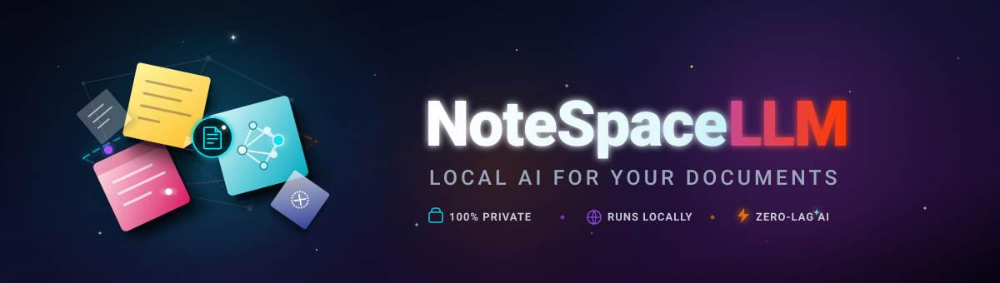

[English](README.md) · [Deutsch](README_de.md) · [Español](README_es.md) · [简体中文](README_zh.md) · [日本語](README_ja.md) · [Русский](README_ru.md)

# NoteSpaceLLM Pro

[](LICENSE)
[](https://www.python.org/)
[]()
[]()

> **本地优先的 NotebookLM 替代方案：用于私密文档分析、RAG辅助研究和多格式报告生成。**

NoteSpaceLLM Pro 是您的私密本地工作空间，专为结构化文档分析、智能笔记整理和人工智能辅助研究打造。作为云端笔记服务的隐私友好替代方案，NoteSpaceLLM 将所有文档和向量索引完整保存在本地设备上。

支持分析 PDF 文件、Word 文档、Markdown、邮件导出、纯文本笔记和研究文件夹。可在完全离线状态下使用本地大模型（如通过 Ollama），也可接入经过安全认证的云端 API（Anthropic Claude、OpenAI）。分析成果支持导出为 Markdown、PDF、DOCX、HTML 与 TXT 格式。附带轻量级 Web/PWA 移动端，无需任何外部服务器即可在 Android、iOS 及现代浏览器中离线查看导出的知识库。

## 快速上手

```bash
git clone https://github.com/file-bricks/NoteSpaceLLM.git
cd NoteSpaceLLM
pip install -r requirements.txt
python main.py
```

Windows 用户亦可通过 `start.bat` 一键启动，或使用 `build_exe.bat` 构建独立运行的 Windows 可执行文件。

运行自动化测试与编译语法检查：

```bash
python -m pytest -q
python manage_translations.py --check
python scripts/check_store_readiness.py
python -m compileall -q main.py manage_translations.py translator.py src
```

## 核心功能

- **文档管理**：支持拖拽导入多种格式文件与文件夹
- **自动索引**：新导入的文档即时进行向量切分并建立 RAG 索引
- **精准选择**：可单独勾选或排除特定文档参与综合报告生成
- **文档子查询**：右键点击单个文档即可发起针对性深度提问
- **工作流可视化**：图形化展现整个分析与报告流水线
- **交互式问答**：基于已载入文档与任意语言模型进行上下文对话
- **深度研究（Deep Research）**：自动提炼要点并生成结构化调研报告
- **多样化导出**：支持 Markdown、PDF、DOCX、HTML 及纯文本
- **提示词导出**：将当前报告上下文保存为 Markdown 提示词供外部模型调用
- **Tier-2 六国语言体系**：界面与元数据全面支持 DE、EN、ES、ZH、JA、RU
- **数据隐私与本地优先**：本地向量库（ChromaDB），无强制云端上传

## 开源许可与隐私声明

NoteSpaceLLM 基于 **AGPL-3.0** 开源许可协议分发。所有文档数据、知识库与向量索引完全保存在您的本地磁盘中。
