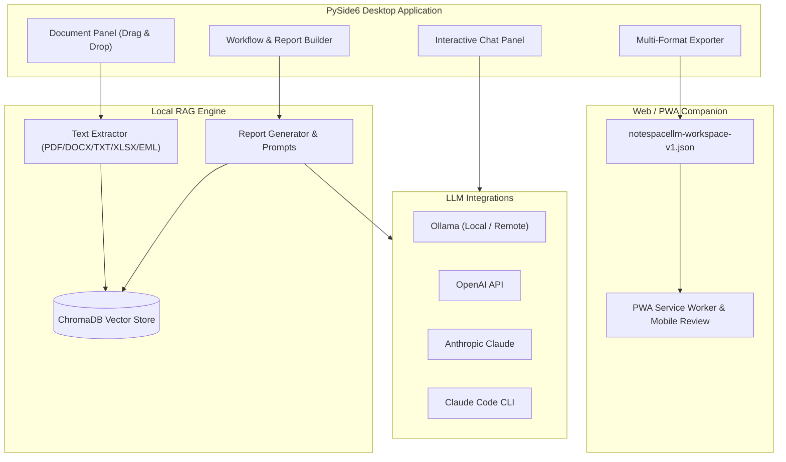

<!-- worldset: {"translated_from_sha256": "5156cab29500f95cbddd18a51dac493ccd36033b452d6cee3bd12f1ad5893194", "translator": "claude-haiku-5-5 with gpt-6-luna/max review and repairs", "translated_at": "2026-10-25T08:23:44.659191+00:00", "reviewer": "Root independent source/literal/encoding checks"} -->


# NoteSpaceLLM

[](LICENSE)
[](https://www.python.org/)
[]()
[](https://github.com/file-bricks)
[](https://github.com/open-bricks)
[](llms.txt)

[English](README.md) | [Deutsch](README_de.md) | [Español](README_es.md) | [简体中文](README_zh.md) | [日本語](README_ja.md) | [Русский](README_ru.md) | [Français](README_fr.md) | [हिन्दी](README_hi.md) | [العربية](README_ar.md) | [বাংলা](README_bn.md) | [Português](README_pt.md)

> **面向研究与报告生成的本地优先文档笔记工具，支持配置本地或远程语言模型。**

> [!NOTE]
> **面向 AI 代理与自动化工作流：**
> NoteSpaceLLM 在 [`llms.txt`](llms.txt) 中提供机器可读的架构与功能概览。

NoteSpaceLLM 是一款基于 PySide6 的本地优先桌面应用，用于处理 PDF、
Word 文件、Markdown、邮件导出、笔记和研究文件夹。它默认将项目数据保存在本地，
支持本地或远程的 Ollama、OpenAI、Anthropic 以及 Claude Code 工作流，并可将分析结果
导出为 Markdown、PDF、DOCX、HTML 和 TXT。现在还提供轻量级 Web/PWA 伴侣应用，
可在 Android、iOS 和浏览器设备上查看已导出的工作区，无需将文档上传至服务器。

**最适合的搜索词：** NotebookLM 替代方案、本地 RAG 文档分析、
本地文档对话、PySide6 研究工具、本地模型报告生成器、本地优先文档工作流。

## 快速开始

```bash
git clone https://github.com/file-bricks/NoteSpaceLLM.git
cd NoteSpaceLLM
pip install -r requirements.txt
python main.py
```

在 Windows 上，也可以通过 `start.bat` 启动。可以使用 `build_exe.bat` 构建本地 Windows 启动器。

如需通过引导式本地初始化来安装依赖并创建入门工作流/配置文件夹，请显式运行 `python setup_environment.py`。包元数据和构建使用单独的 setuptools 入口点，不会运行该步骤。

运行测试和编译冒烟检查：

```bash
pytest
python -m compileall -q main.py manage_translations.py setup_environment.py translator.py src
cd web_companion
npm test
```

## 系统架构



## 功能特性

- **文档管理**：通过拖放添加文件和目录
- **自动提取与索引**：新文档会立即处理并为 RAG 做好准备。
- **选择性分析**：勾选或取消勾选文档，以决定是否将其纳入报告
- **子查询**：右键单击文档，进行针对特定文档的定向研究
- **工作流可视化**：报告流程的图形化概览
- **聊天界面**：可与任意 LLM 对已加载文档进行交互式对话
- **Claude Code 集成**：返回结构化 API 响应，或移交至交互式 Claude Code 会话
- **多格式导出**：输出为 MD、PDF、DOCX、HTML、TXT
- **提示词导出**：将报告上下文保存为 Markdown 提示词，用于外部 LLM 工作流
- **Ollama 连接配置**：应用级提供方设置可在多个项目间复用
- **语言支持**桌面界面和 Web/PWA Companion 均提供持久保存的语言选择器，支持英语、德语、西班牙语、简体中文、日语、俄语、法语、印地语、阿拉伯语、孟加拉语和葡萄牙语。阿拉伯语界面采用从右向左的布局。项目语言字段是工作区导出的元数据；它不会切换界面语言，也不会决定生成报告的语言。
- **德语变音符号兼容界面**：德语界面文本使用原生字符；翻译扫描器可避免将英语文本误报为问题
- **配置文件**：可复用的输出格式组合

## 安装

```bash
# Clone or copy the project folder
cd NoteSpaceLLM

# Install dependencies
pip install -r requirements.txt

# Start the app
python main.py
```

检查依赖项：

```bash
python main.py --check
```

## LLM 配置

### Ollama（本地 — 推荐）

1. [安装 Ollama](https://ollama.ai)
2. 下载模型：`ollama pull llama3`
3. 在应用中：菜单 > LLM > 使用 Ollama

### Ollama（远程服务器）

NoteSpaceLLM 可以连接远程 Ollama 服务器，例如通过 [ellmos-stack](https://github.com/ellmos-ai/ellmos-stack)：

1. 在应用中：菜单 > LLM > 设置
2. **Ollama URL：** `http://your-server:11435`（或您的端口）
3. **API Key：** 如果服务器位于认证代理之后（推荐）

> **提示：** Ollama 没有内置身份验证。如需远程访问，请使用带有 API Key 或 Basic Auth 的反向代理（例如 Nginx）。

Ollama 端点和模型在应用级设置或所选连接配置文件中配置，而不是按项目配置。在应用中保存 API Key 时，会通过操作系统的凭据存储进行保存。可选的 `NOTESPACELLM_OLLAMA_API_KEY` 环境变量会覆盖已保存的密钥，且应用从不写入该变量。旧版明文密钥在您于设置中显式迁移之前不会被发送。

当配置的 Ollama 服务器为远程服务器时，它会接收用于嵌入的文档文本，以及用于生成的提示和上下文。API 密钥会以 Bearer 请求头的形式发送到所配置的 URL。纯 HTTP 不会加密内容或凭据；HTTPS 的行为取决于端点及其证书。

### OpenAI

```bash
export OPENAI_API_KEY="<your-openai-api-key>"
```

### Anthropic (Claude)

```bash
export ANTHROPIC_API_KEY="<your-anthropic-api-key>"
```

### Claude Code

需要本地 CLI:

```bash
npm install -g @anthropic-ai/claude-code
```

应用中提供两种模式:
- **API 模式**:结构化响应直接返回到 NoteSpaceLLM
- **聊天模式**:将提示交给交互式 Claude Code 控制台

## 用法

### 1. 添加文档

- **拖放**:将文件或文件夹拖入左侧面板
- **按钮**:"Add files"(添加文件)或 "Add folder"(添加文件夹)

### 2. 选择文档

- 复选框:包含/排除用于分析的文档
- 按钮:"All"(全选)/ "None"(全不选),用于批量选择

### 3. 子查询(可选)

右键单击文档:
- **Create summary**(创建摘要):自动生成摘要
- **Extract information**(提取信息):查找特定数据
- **Analyse**(分析):有针对性的分析
- **Ask question**(提问):关于该文档的具体问题

### 4. 定义主要问题

在工作流面板中输入核心研究问题。

### 5. 选择工作流/报告类型

- **Analysis**(分析):包含建议的综合分析
- **Summary**(摘要):简短摘要
- **Research report**(研究报告):学术结构
- **Comparison**(对比):系统的文档对比

### 6. 生成报告

点击 "Create report"(创建报告),输出结果会显示在右侧面板中。

### 7. 导出

选择输出格式并点击 "Export"(导出)。

### 8. 提示导出

使用 **"Export prompt"**(导出提示)将当前工作上下文保存为 Markdown 文件,以便在 Claude Code 或其他 LLM 工作流中使用。

## Web/PWA 配套应用

`web_companion/` 下是一个面向 Android、iOS 和浏览器的只读配套应用分支。它会在浏览器中本地导入已导出的 `notespacellm-workspace-v1.json` 文件,显示报告、文档元数据和所选摘录,并可将审阅笔记导出为 Markdown。工作区仅保留在当前浏览器会话中,重新打开后必须重新导入;只有审阅笔记和界面语言会在本地持久保存。

本地浏览器测试:

```powershell
$env:PYTHONIOENCODING='utf-8'
python -m http.server 8765 -d web_companion
```

配套应用冒烟测试:

```powershell
cd web_companion
node --test tests/library.test.mjs
```

Android/iOS PWA 测试计划记录在 `web_companion/PWA_TESTPLAN.md` 中。

## 平台策略

桌面应用是完整应用,用于本地文档、RAG 索引和提供商连接。Android、iOS 和浏览器 Web/PWA 配套应用可用于审阅用户创建的 `notespacellm-workspace-v1.json` 导出文件。对于敏感材料,请配置本地模型和嵌入端点,并在分享前审阅导出内容。交换约定记录在 `EXPORTFORMAT.md` 中。

### macOS 和 Linux 源码冒烟测试

GitHub Actions 中运行以下额外的源码冒烟测试:
- `tests/platform_smoke.py` — 离屏 PySide6 启动、文档导入、报告导出、工作区 JSON 导出
- `tests/linux_platform_smoke.py` — `ubuntu-latest` 的 Linux 专用包装器

## 项目结构

```
NoteSpaceLLM/
├── main.py                 # Entry point
├── requirements.txt        # Dependencies
├── translator.py           # Translation system and catalog scanner used by the desktop UI
├── locales/                # Catalog inputs for the translation helper
├── src/
│   ├── core/              # Core functionality
│   │   ├── document_manager.py
│   │   ├── text_extractor.py
│   │   ├── sub_query.py
│   │   └── project.py
│   ├── gui/               # PySide6 UI
│   │   ├── main_window.py
│   │   ├── document_panel.py
│   │   ├── workflow_panel.py
│   │   ├── chat_panel.py
│   │   └── output_panel.py
│   ├── llm/               # LLM integration (local + remote)
│   │   ├── client.py
│   │   ├── ollama_client.py
│   │   ├── openai_client.py
│   │   └── anthropic_client.py
│   └── reports/           # Report generation
│       ├── generator.py
│       ├── templates.py
│       └── exporter.py
├── web_companion/         # PWA Companion
├── data/                  # Project data (gitignored)
├── workflows/             # Workflow definitions
├── profiles/              # Output profiles
└── output/                # Exported reports
```

## 支持的文件格式

| 格式 | 读取 | 写入 |
|------|------|------|
| PDF  | ✅   | ✅   |
| DOCX | ✅   | ✅   |
| DOC  | ⚠️   | —    |
| TXT  | ✅   | ✅   |
| MD   | ✅   | ✅   |
| XLSX | ✅   | —    |
| HTML | —    | ✅   |
| EML  | ✅   | —    |
| MSG  | ✅   | —    |

⚠️ .doc 需要 antiword 或 LibreOffice

## 隐私

NoteSpaceLLM 将项目数据、文档索引、配置文件、工作流设置和导出内容本地存储在 `data/`、`profiles/`、`workflows/`、`output/` 和 `chroma_db/` 中。这些文件夹有意排除在 Git 之外。

启用外部 LLM 提供商(OpenAI、Anthropic、Claude Code、远程 Ollama)时,提示和所选文档摘录可能会被传输到这些服务。远程 Ollama 端点还会接收用于嵌入的文档文本。对于敏感文档,请使用本地模型和嵌入端点,并在分享前审阅导出的报告、聊天记录和所选摘录;工作区导出内容未经匿名化处理。

## 提示

1. **大型文档集**:先只选择相关文档,以获得更快的结果
2. **子查询**:使用有针对性的子查询以获得更高质量的分析
3. **Ollama**:本地 Ollama 端点支持离线处理。
4. **工作流顺序**:可在工作流面板中重新排列步骤

## 许可证

AGPL-3.0-only — 参见 [LICENSE](LICENSE)

本项目声明使用 PySide6 和 PyMuPDF。所选上游许可证参考请见 [THIRD_PARTY_LICENSES.md](THIRD_PARTY_LICENSES.md);本项目自身的许可证为 AGPL-3.0-only。

## 相关项目

[KnowledgeDigest](https://github.com/file-bricks/KnowledgeDigest) 是一个独立的本地知识数据库,具有 SQLite/FTS5 搜索和可选的 LLM 摘要功能;它未与 NoteSpaceLLM 集成。

## 许可证与维护声明

项目的许可条款请参见 [LICENSE](LICENSE)。维护者不承诺持续维护或可用性。
